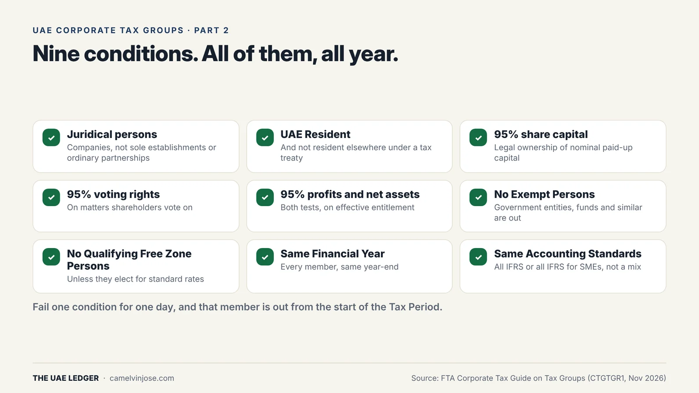
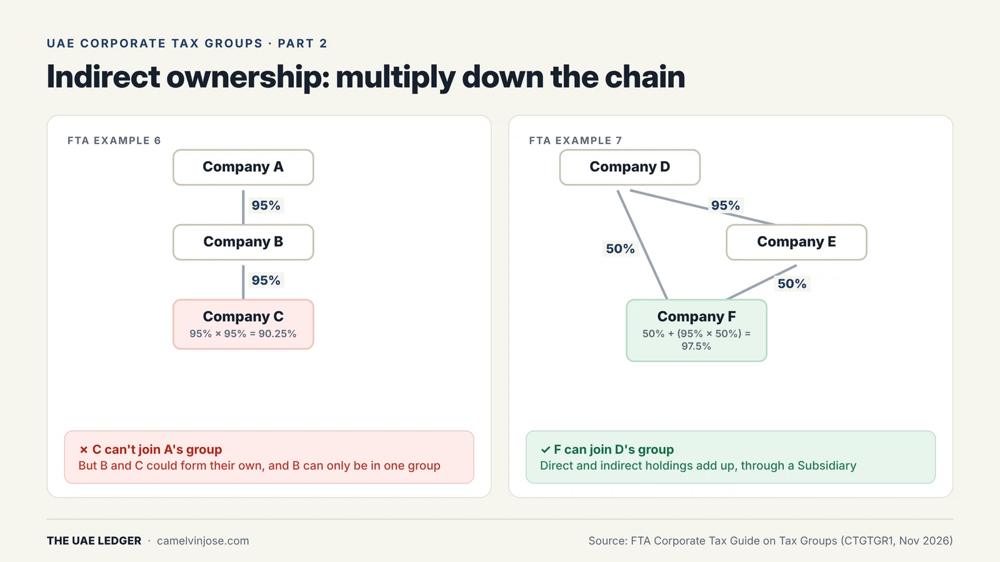
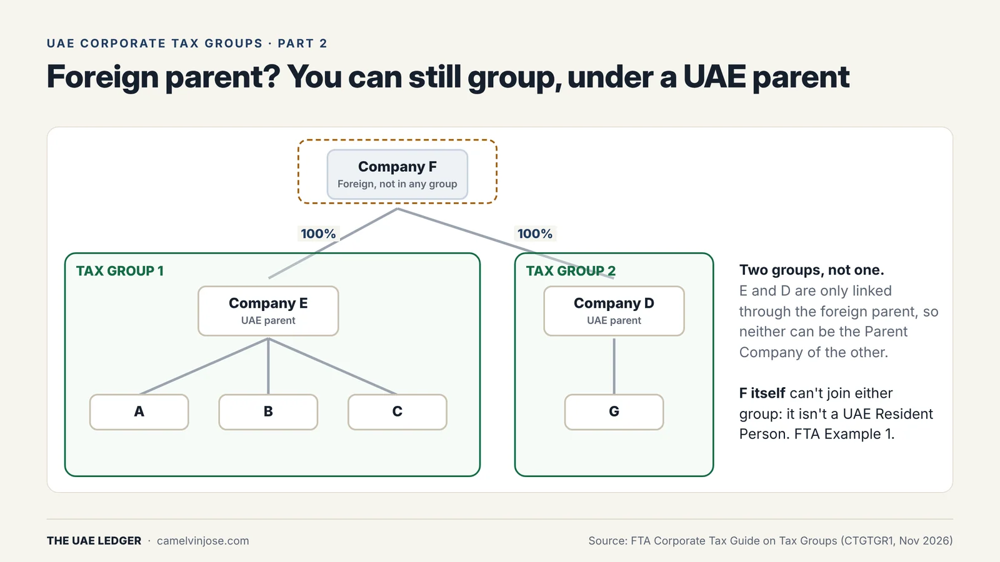
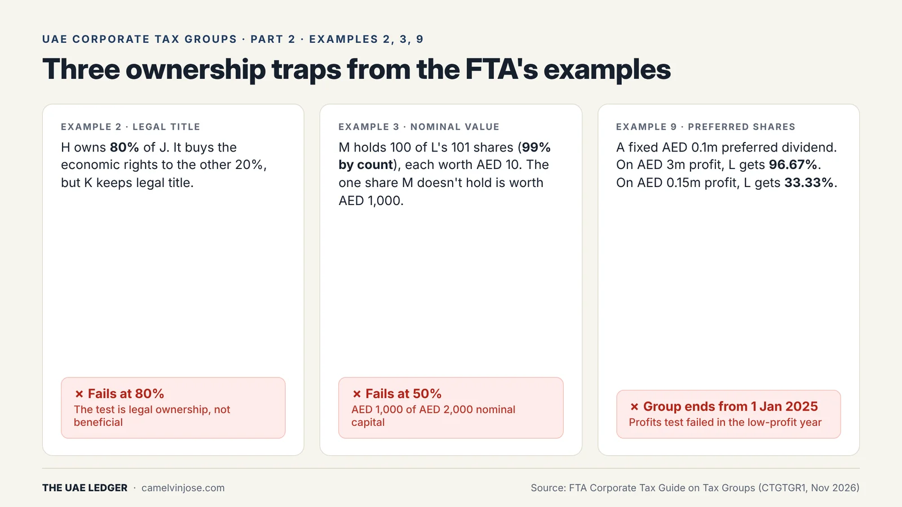

[Part 1]() covered what a Tax Group gets you. This part covers who qualifies. Most groups that fail don't fail on the obvious conditions. They fail on how "95%" is measured.

### The nine conditions

{: width="1600" height="900" loading="lazy" decoding="async"}

Under Article 40(1) of the Corporate Tax Law, the Parent Company and every Subsidiary must be:

1. **Juridical persons.** Companies qualify. A sole establishment run by an individual doesn't. An ordinary unincorporated partnership doesn't either, unless the FTA has approved it as a Taxable Person in its own right.
2. **UAE Resident Persons**, and **not** treated as tax resident in another country under a tax treaty the UAE has in force.
3. **95% share capital.** The Parent owns at least 95%, directly or through Subsidiaries.
4. **95% voting rights.**
5. **95% of profits and net assets.** Both tests must be met.
6. **Not Exempt Persons.** That rules out Government Entities themselves, though their taxable subsidiaries can group in certain cases.
7. **Not Qualifying Free Zone Persons.** A free zone company that isn't a QFZP can join, and so can a QFZP that has elected to pay the standard rates.
8. **On the same Financial Year.**
9. **Using the same Accounting Standards.** All IFRS, or all IFRS for SMEs, but not a mix.

And the rule that catches people out: **every condition must be met continuously for the whole Tax Period.** Miss one for a single day and that company is out of the group from the start of the year (Part 3).

### Trap 1: indirect ownership only counts through Subsidiaries

{: width="1600" height="900" loading="lazy" decoding="async"}

Indirect holdings count, but **only through companies that are themselves in the group**. Percentages multiply down the chain:

- **Example 6:** A owns 95% of B, and B owns 95% of C. A's indirect stake in C is 95% × 95% = **90.25%**, so C can't join A's group. B and C could form their own group, but B can only be in one group at a time.
- **Example 7:** D owns 50% of F directly and 95% of E, and E owns the other 50% of F. D's total stake in F is 50% + (95% × 50%) = **97.5%**, so F can join.

It also means one non-qualifying company in the middle breaks the chain for everything below it. **In Example 4**, the middle company P is a Qualifying Free Zone Person. So N can group with neither P nor P's 100% subsidiary Q.

### Trap 2: a foreign parent can't be in the group

{: width="1600" height="900" loading="lazy" decoding="async"}

A foreign company that isn't UAE resident can't be a member. Its UAE subsidiaries can still group, but **only under a UAE resident Parent Company**.

In Example 1, foreign Company F owns two separate UAE holding companies, E and D. You end up with **two Tax Groups** (E with A, B and C; D with G), not one. E and D are linked only through the foreign parent, so neither can be the Parent of the other.

**What to do about it:** if you want one UAE group, you need one UAE holding company above all the UAE entities.

### Trap 3: how "95%" is measured

{: width="1600" height="900" loading="lazy" decoding="async"}

- **Legal title, not economic ownership (Example 2).** H owns 80% of J and buys the economic rights to the other 20%, but K keeps the legal title. The share capital test looks at legal ownership, so H fails at 80%. Nominee arrangements don't count.
- **Nominal value, not share count (Example 3).** M holds 100 of L's 101 shares, which is 99% by count. But M's shares are worth AED 10 each and the one share M doesn't hold is worth AED 1,000. By nominal value M owns 50%, and fails.
- **Profit entitlement can drop below 95% (Example 9).** A preferred shareholder takes a fixed AED 0.1m dividend. In a year with AED 3m profit, the ordinary shareholder gets 96.67% and passes. In a year with AED 0.15m profit, it gets 33.33%. The group then **ends from the start of that year**, and the FTA must be notified within 20 business days of the year end.

Also: convertible loans, warrants and options don't count as share capital. On voting rights, non-voting shares are excluded, but a minority holder's right to appoint a director doesn't break the test by itself as long as the Parent keeps at least 95% of shareholder votes.

### Fixing a Financial Year mismatch

If everything else lines up but the year-ends don't, a company can apply to the FTA to change its Tax Period. The adjusted period can't be shorter than **6 months** or longer than **18 months**. In Example 10, P (December year-end) buys Q (August year-end) in May 2024. They can align either way: P moves to August and they group from 1 September 2025, or Q moves to December and they group from 1 January 2025.

### Before you apply: a quick check

- Draw the legal ownership chart and calculate each member's percentage by **nominal value**, multiplying down every chain.
- Check every company in the chain is resident, isn't a QFZP and isn't exempt.
- Check shareholder agreements and any preferred shares for **profit and liquidation rights**, not just votes.
- Confirm one year-end and one accounting standard for everyone.

**[Next, Part 3]():** joining, leaving and closing a group, and why a 7-day share transfer can cost a company a whole year.
