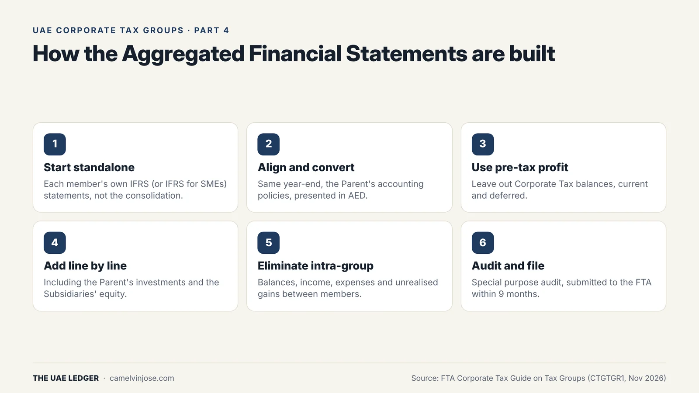
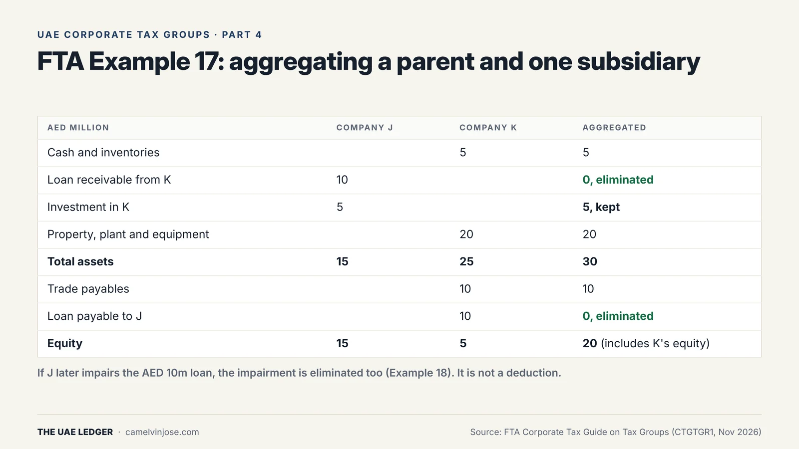
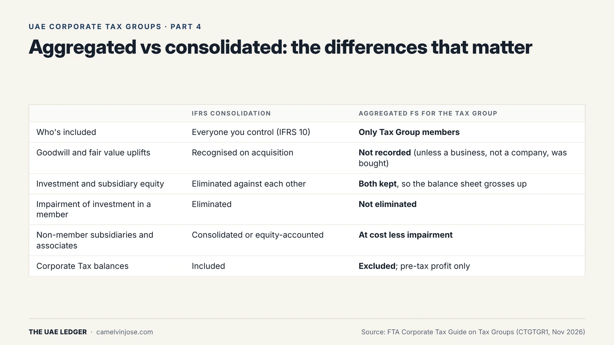

A Tax Group has one Taxable Income, and it starts from one number: the profit in the group's **Aggregated Financial Statements**. These aren't the consolidated accounts most groups already prepare. Getting the difference wrong changes the tax.

This is Part 4. Parts [2]() and [3]() covered who's in the group; this part covers how their results are combined.

### How they're built

{: width="1600" height="900" loading="lazy" decoding="async"}

The framework comes from FTA Decision No. 7 of 2025 and Ministerial Decision No. 84 of 2025. In practice:

1. **Start from each member's own statements** (IFRS or IFRS for SMEs), not the consolidation.
2. **Align** them: same year-end, the **Parent's accounting policies** applied throughout, presented in **AED**.
3. **Take pre-tax profit.** Corporate Tax balances, current and deferred, are left out. Foreign taxes and other non-Corporate Tax taxes stay in.
4. **Add the statements up line by line.**
5. **Eliminate transactions between members:** intra-group balances, income, expenses and unrealised gains. Dividends paid between members drop out as well.
6. **Get a special purpose audit** and submit it to the FTA within **9 months** of the year end. The members' own statements don't need auditing for Corporate Tax purposes.

### A worked example

{: width="1600" height="900" loading="lazy" decoding="async"}

In **FTA Example 17**, J owns 100% of K and lends it AED 10m:

- The **AED 10m loan** is eliminated on both sides.
- J's **AED 5m investment in K** is **kept**, and so is K's equity.
- Aggregated total assets come to AED 30m and equity to AED 20m, which includes K's equity held by J.

Keeping both the investment and the equity grosses up the balance sheet. That's deliberate: it keeps goodwill and acquisition fair-value adjustments out of the tax base.

**Example 18** follows on. If J impairs the AED 10m loan to K, that impairment is **eliminated too**. A loan write-off between members doesn't reduce the group's tax.

### Aggregated is not consolidated

{: width="1600" height="900" loading="lazy" decoding="async"}

In short: only Tax Group members go in, goodwill and fair value uplifts from buying a company are left out, the investment and the subsidiary's equity are both kept, an impairment of an investment in a member is not eliminated, and non-member subsidiaries and associates are carried at cost less impairment.

**One exception:** if a member buys a *business*, meaning assets rather than shares in a company, the resulting goodwill and fair values are in that member's own books, so they **are** aggregated (Example 16).

If you have subsidiaries that aren't in the Tax Group, like a QFZP or a foreign company, transactions with them are **not** eliminated and their accounts are **not** added in.

### The exception for losses claimed before joining

Normally every intra-group transaction is eliminated. But if a member **deducted a loss before joining the group**, for example by impairing a loan to another member, then a later reversal of that loss **isn't** eliminated. It's taxed in the group, up to the amount originally deducted.

This works one way only. Further impairments after joining are still eliminated and give no deduction. Only the reversal of the earlier deduction is taxed.

### Other points that change the number

- **Subsidiaries with minority shareholders.** All of the subsidiary's income goes into the group's Taxable Income, not just the Parent's share.
- **Deductible expenses are judged across the group.** A cost one member incurs for another member's business can be deductible. A cost incurred for a non-member's business, like a foreign parent's, isn't.
- **Disclosures.** The statements must state the special purpose framework, list each member with the Parent's percentage of share capital, voting rights and profit and net asset entitlement, and show comparatives from the group's second year onwards.

### What to do this quarter

If you're in a group, or planning one, set up a separate **aggregation workbook** next to your consolidation. It should start from members' standalone pre-tax figures, not the consolidated pack, and keep an elimination schedule that the auditor can trace line by line.

**[Next, Part 5]():** moving assets between members is tax-free, until someone leaves within 2 years.
