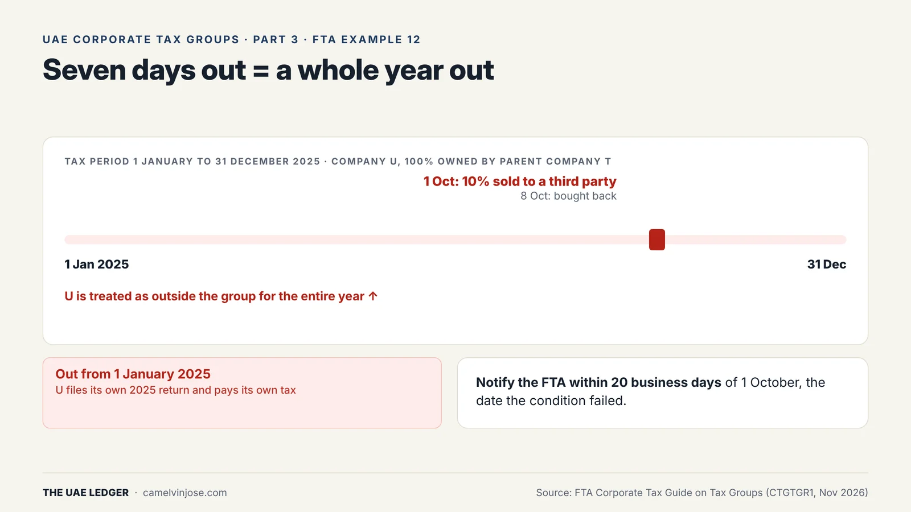
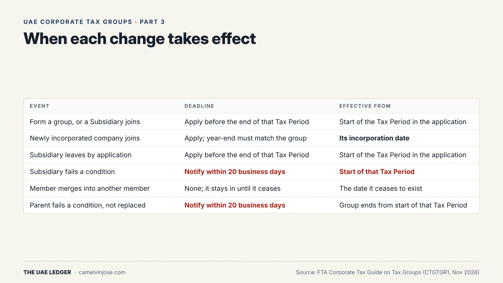
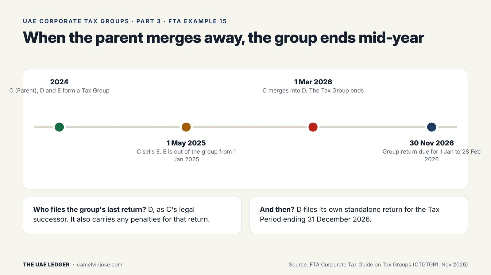

Groups change. Companies are bought, sold, merged and set up. Under the Tax Group rules, **when** a change takes effect is often more surprising than the change itself.

This is Part 3. [Part 2]() covered the conditions; this part covers what happens when they stop being met.

### The core rule: whole periods, not days

A company has to meet every condition **continuously throughout the Tax Period**. There's no apportionment. If it fails for part of a year, it's treated as outside the group for the **whole** year.

{: width="1600" height="900" loading="lazy" decoding="async"}

**FTA Example 12.** T (the Parent) owns 100% of U. On 1 October 2025, T transfers 10% of U to a third party, and on 8 October buys it back. For seven days, T's stake was 90%.

**The result:**
- U is out of the group **from 1 January 2025**.
- U files its own 2025 Tax Return and pays its own tax.
- T has to **notify the FTA within 20 business days of 1 October**, the day the condition failed.

**The lesson:** run any share movement involving a group member past the tax team first. That includes "temporary" transfers, nominee changes and new share issues.

### When each change takes effect

{: width="1600" height="900" loading="lazy" decoding="async"}

- **Forming, joining, leaving or closing by application:** apply through EmaraTax **before the end of the Tax Period** you want the change to apply to. It takes effect from the **start** of that period, or from another period the FTA decides on.
- **A newly incorporated company** can join **from its incorporation date**, as long as its first year-end matches the group's. In Example 11, a subsidiary set up on 15 September 2024 joins from that date. It doesn't have to wait until 1 January 2025.
- **A member that fails a condition** is out from the start of that Tax Period, and the FTA must be notified within **20 business days**.
- **A member that merges into another member** stays in the group until the date it ceases to exist.

FTA approval also isn't a permanent green light. If the conditions aren't met throughout the group's **first** period, the FTA treats the group, or that member, as **never having been formed** for that period, even though it approved the application.

### Selling a subsidiary

When a member is sold to a buyer outside the group:
- it leaves **from the start of the Tax Period** in which the sale happens, and so do any subsidiaries below it,
- the **buyer** can't group with it for that period either, because neither side owned it for the whole year.

On timing: for the share capital test, the seller remains the owner **until legal title passes**. Signing the share purchase agreement isn't enough. For the profits and net assets test, the buyer is generally treated as entitled once the agreement becomes **unconditional**.

### When the Parent Company changes

A group can carry on under a new Parent Company in two situations:
1. the new Parent meets all the conditions in relation to the old Parent, for example a holding company above it that becomes eligible, or
2. the old Parent ceases to exist and the new Parent, or a Subsidiary, is its **universal legal successor** (for example, after a merger).

You apply before the end of the relevant Tax Period, and you can do so while the merger is still being prepared.

{: width="1600" height="900" loading="lazy" decoding="async"}

**FTA Example 15** puts several rules together:
- C (the Parent), D and E form a group in 2024.
- C sells E on 1 May 2025, so **E is out from 1 January 2025**. C and D carry on as a group.
- On 1 March 2026, C merges into D. Only one member is left, so **the group ends that day**.
- D, as C's successor, files the group's final return for **1 January to 28 February 2026**, due **30 November 2026**. D is also liable for any penalties on that return.
- D then files its own standalone return for the year to 31 December 2026.

Two returns for one calendar year, from one surviving company.

### After a company leaves

- It **keeps its own TRN**. It doesn't deregister, and it files standalone returns from then on.
- It **stays jointly liable** for the group's tax for the years it was a member, unless that liability was limited.
- If it ceases to exist (dissolved or liquidated, rather than merged into another member), it must apply to **deregister within 3 months**.
- A company or group that has left can **rejoin or re-form** in a later period by applying again.

### Get it wrong and the cost compounds

If nobody spots that a member dropped out, the group's return is wrong and has to be corrected. The Parent carries the penalties for that. The member that dropped out may **also** face penalties for not filing its own return. Keep a monthly check of who owns what for every group member.

**[Next, Part 4]():** how the group's taxable income is built from Aggregated Financial Statements, and why your IFRS consolidation won't do.
