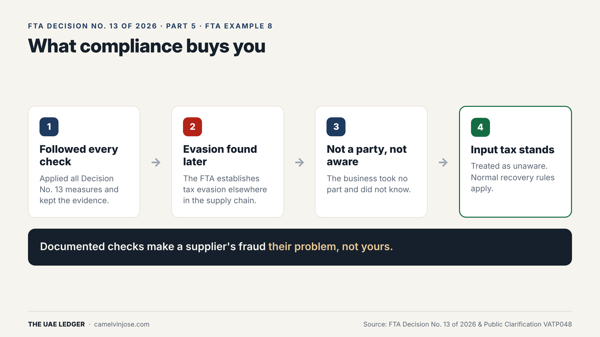
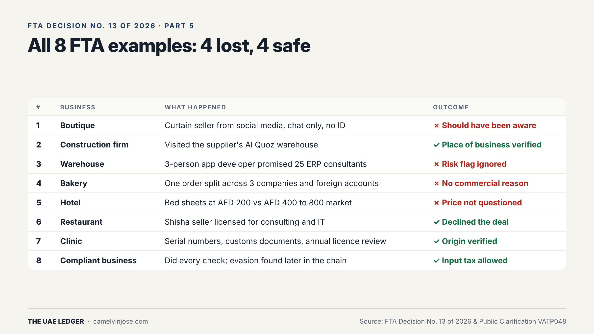
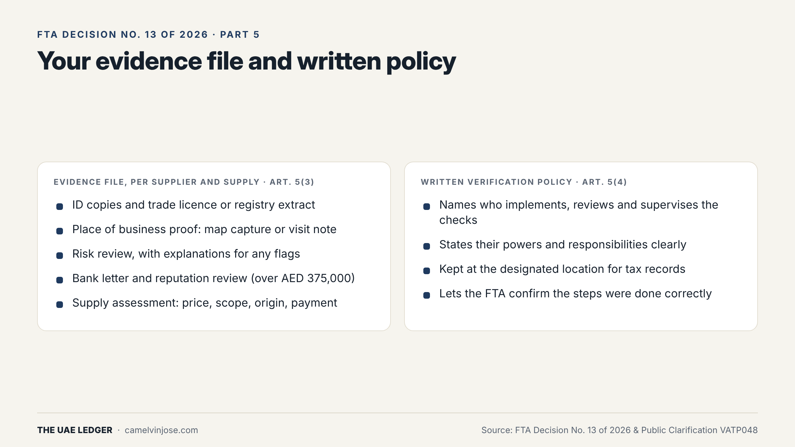
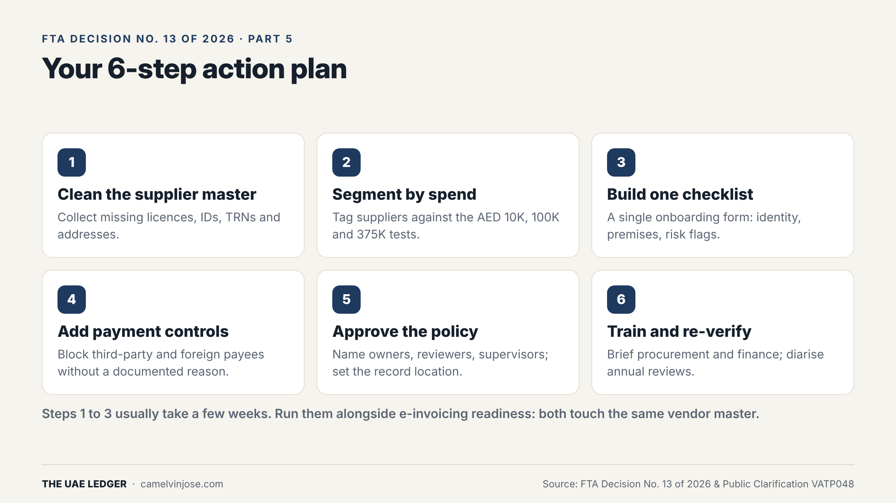

Parts [2](), [3]() and [4]() covered the checks. This part covers the thing that makes them count: **proof**.

A check you did but can't show is, for the FTA's purposes, a check you didn't do.

### Why bother: FTA Example 8

Example 8 is the FTA's positive case:

1. The business **applied all the Decision No. 13 measures** and kept the documentary evidence.
2. The FTA later **establishes tax evasion elsewhere in the supply chain**.
3. The business took no part in the evasion and **did not know of it**.
4. It is **treated as unaware**, and the normal input tax recovery rules apply. **The input tax stands.**

Same evasion in the chain as the businesses that lost. The difference is the file. Documented checks turn a supplier's fraud into **their** problem, not yours.

### All eight FTA examples, side by side

Look at the four that lost: no ID, an ignored red flag, no reason for foreign accounts, an unquestioned price. **None of them needed expensive tools.** Every one could have been avoided with a few minutes of checking and a note on file.

### What goes in the file

**Evidence file, per supplier and supply (Article 5(3))**
- ID copies and trade licence or registry extract
- Place of business proof: map capture or visit note
- Risk review, with explanations for any flags
- Bank letter and reputation review (over AED 375,000)
- Supply assessment: price, scope, origin, payment

**Written verification policy (Article 5(4))**
- Names who implements, reviews and supervises the checks
- States their powers and responsibilities clearly
- Kept at the designated location for tax records
- Lets the FTA confirm the steps were done correctly

The policy is easy to skip because it feels like paperwork. Don't skip it. It's what turns "our accountant usually checks" into a control the FTA can rely on.

### Your 6-step action plan

1. **Clean the supplier master.** Collect missing licences, IDs, TRNs and addresses.
2. **Segment by spend.** Tag every supplier against the AED 10,000, 100,000 and 375,000 tests (see Part 3).
3. **Build one checklist.** A single onboarding form covering identity, premises and risk flags.
4. **Add payment controls.** Block third-party and foreign payees unless there is a documented reason.
5. **Approve the policy.** Name owners, reviewers and supervisors; set the record location.
6. **Train and re-verify.** Brief procurement and finance; diarise annual reviews.

Most businesses can finish steps 1 to 3 in a few weeks. If you're also preparing for e-invoicing, run both projects together: they touch the same vendor master, so you only clean it once.

### The series in one paragraph

A valid tax invoice no longer guarantees input VAT recovery. If the FTA establishes evasion in your supply chain, you keep your claim only if you can show you verified **the supplier** (identity, premises, red flags, plus bank and reputation over AED 375,000) and **the supply** (reason, payment, price, licence, origin), at the depth your **spend** requires, and **documented** all of it under a written policy. Do that, and you're Example 8. Skip it, and you're one of the other four.
