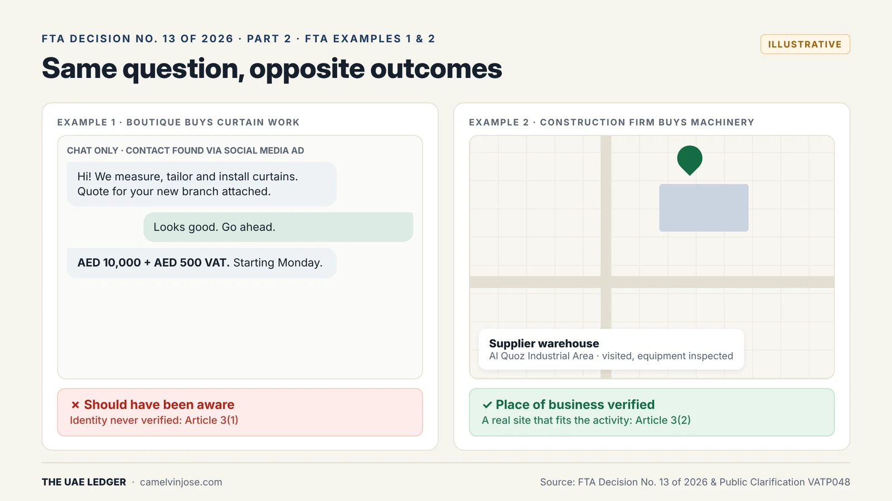
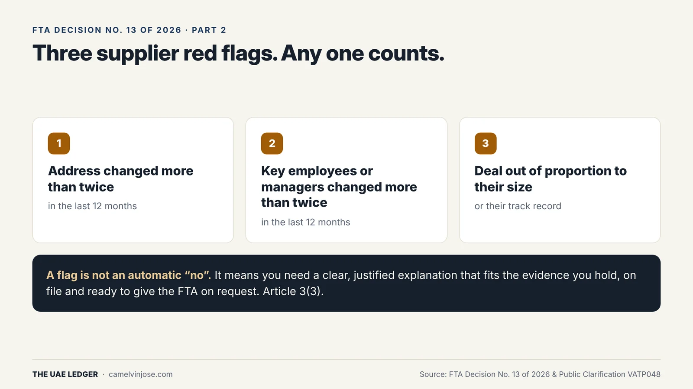
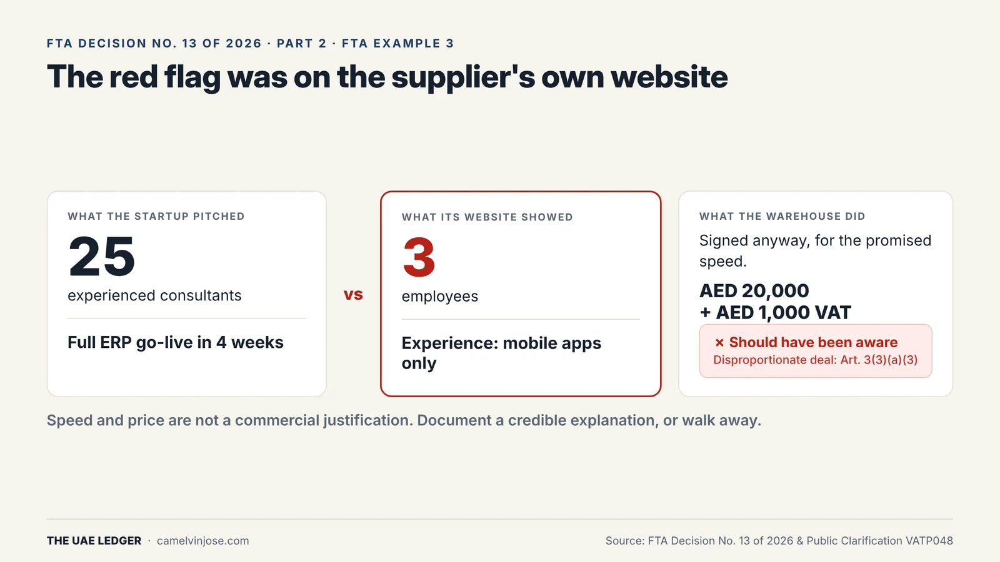

In [Part 1]() we saw that your input VAT is now only as clean as your supplier. So the obvious next question: **how well do you actually know your suppliers?**

For many SMEs, the honest answer is "a phone number and a TRN." Article 3 of Decision No. 13 asks for three things more.

### Check 1: Who are they?

What you need depends on whether the supplier is an individual or a company.

**Individual supplier (natural person)**
- A copy of a valid ID: Emirates ID or passport.
- Meet them **before any VAT-able supply**: in person, by phone or by video call.

**Company supplier (legal person)**
- Verify incorporation using official databases (for example, the ADGM or DIFC registries), or the certificate of incorporation or trade licence.
- The details must be valid and match the name, address and employees.
- A valid ID for the director, agent or authorised employee you deal with.

The common SME gap is freelancers and small contractors sourced online, with no ID on file. A two-minute video call and an ID copy closes it.

### Check 2: Do they actually exist somewhere?

This applies to individuals and companies alike. Confirm there is a **real place of business**, using map and navigation platforms or a site visit. It must also **fit the activity**: a machinery supplier should have a yard or warehouse, not a desk in a shared office.

### FTA Examples 1 and 2: same question, opposite outcomes

{: width="1600" height="900" loading="lazy" decoding="async"}

**Example 1: the boutique.** A boutique opening a new branch finds a curtain specialist through social media ads. All communication happens on WhatsApp. The supplier's identity is never verified. The job is billed at AED 10,000 + AED 500 VAT for measuring, tailoring and installing.

**Result:** if evasion is established, the boutique *should have been aware*. Identity was never verified under Article 3(1). Note that the job was not below AED 10,000, so the small-supply exception (Part 3) didn't help.

**Example 2: the construction firm.** A construction company needs light machinery and contacts a newly registered industrial supplier. Its representatives visit the supplier's warehouse in Al Quoz Industrial Area and evaluate the equipment before completing the purchase.

**Result:** the place of business check is met under Article 3(2). A real warehouse that fits a machinery business.

The difference isn't the size of the business or the deal. It's that one buyer looked and the other didn't.

### Check 3: Any red flags?

{: width="1600" height="900" loading="lazy" decoding="async"}

Decision No. 13 lists three risk indicators. **Any one of them counts as a flag:**

1. The supplier's **address changed more than twice** in the last 12 months.
2. **Key employees or managers changed more than twice** in the last 12 months.
3. The deal is **disproportionate to the supplier's size or track record**.

A flag is not an automatic disqualification. It means you need a clear, justified explanation that is consistent with the evidence you hold, kept on file and ready to give the FTA on request.

### FTA Example 3: the flag that was ignored

{: width="1600" height="900" loading="lazy" decoding="async"}

A large warehouse needs a new ERP system for real-time inventory and delivery insight. A startup software firm says it has a team of **25 experienced consultants** and can go live in **4 weeks**.

The startup's own website shows **3 employees**, with experience only in **mobile apps**.

The warehouse signs anyway, because of the promised speed: AED 20,000 + AED 1,000 VAT.

**Result:** if evasion is established, the warehouse *should have been aware*. The disproportionate-transaction indicator under Article 3(3)(a)(3) was visible from public information.

Three lessons:

- The mismatch was on the supplier's **own website**. That is exactly the kind of check the FTA expects you to do.
- **Speed or price is not a commercial justification.**
- Finding a flag is fine. Proceeding **without a documented explanation** is the problem. Either write down a credible reason, or walk away.

### Your supplier checklist (copy this)

For every new supplier, before the first VAT-able supply:

- ID copy (individual) or registry extract / trade licence + authorised person's ID (company)
- Name, address and people match across documents
- Place of business confirmed by map capture or visit note, and it fits the activity
- Address changes in last 12 months: ___ (flag if more than 2)
- Key staff changes in last 12 months: ___ (flag if more than 2)
- Deal size vs supplier size and track record: proportionate? If not, explanation attached

**[Next, Part 3]():** how much of this you need depends on how much you spend. AED 10,000, 100,000 and 375,000 are the three numbers that set the depth of your checks.
