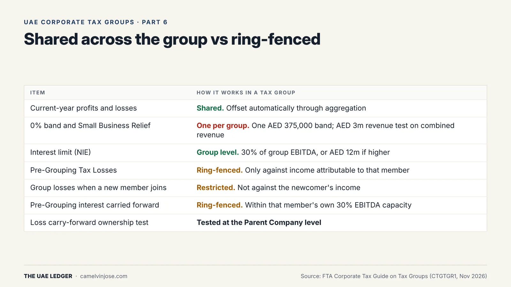
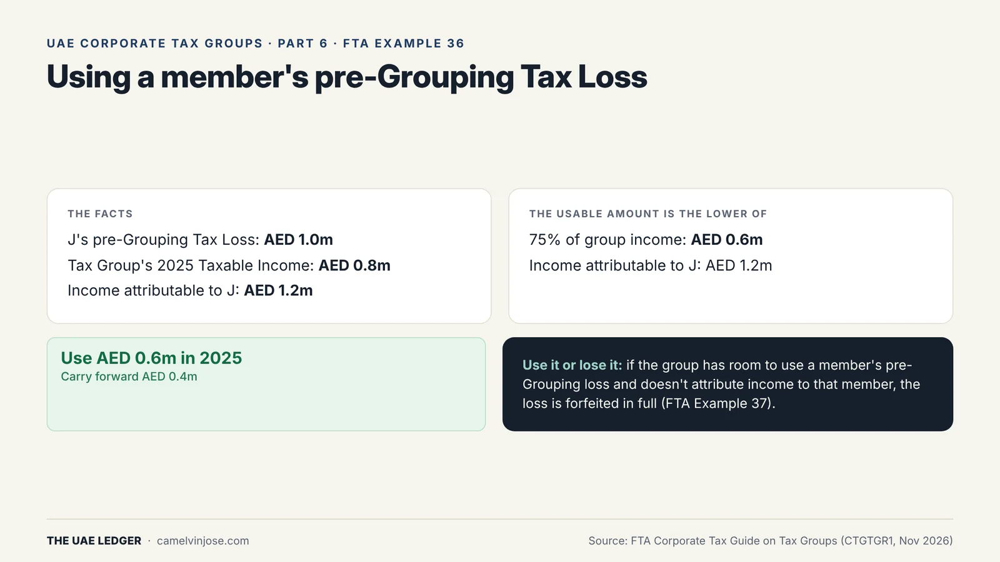
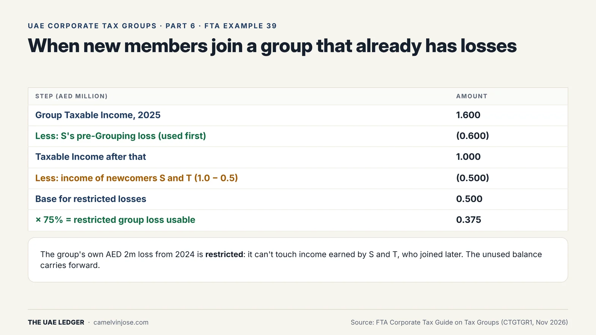
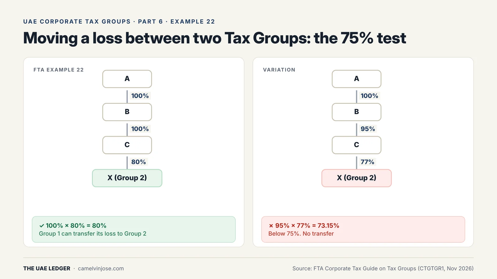

Pooling profits and losses is the main reason most groups form a Tax Group ([Part 1]()). But not every loss pools. Losses brought in from before the group, and a group's existing losses when a new member joins, are ring-fenced. Handle them wrong and they're forfeited.

This is the final part of the series.

### What's shared and what's ring-fenced

{: width="1600" height="900" loading="lazy" decoding="async"}

**Applied to the group as a whole:**
- **Current-year results.** One member's loss offsets another's profit automatically.
- **The 0% band.** The group gets one AED 375,000 band, however many members it has.
- **Small Business Relief.** Available only if the group's **combined** revenue is AED 3 million or less in the current and every previous Tax Period, and no member belongs to a large multinational group that has to file Country-by-Country Reports.
- **The interest limit.** If net interest expense goes over AED 12 million, the deduction is capped at the higher of 30% of the **group's** EBITDA or AED 12 million. One highly geared member can shelter behind the others' EBITDA. The flip side is that a member with enough EBITDA on its own can still be restricted if the group as a whole doesn't have enough.
- **Participation Exemption thresholds.** The 5% holding and AED 4 million cost tests are met by combining holdings across members, and across their Qualifying Group.

**Ring-fenced:**
- **Pre-Grouping Tax Losses**, meaning a member's losses from before it joined.
- **Restricted losses**: the group's own losses when a new member joins.
- **Pre-Grouping interest** carried forward.

### Using a member's pre-Grouping loss

To use a member's old losses, the group has to **work out the Taxable Income attributable to that member**, as if it were filing alone. The loss can only be set against that income, and the usual **75% cap** applies to the **group's** Taxable Income.

{: width="1600" height="900" loading="lazy" decoding="async"}

In **FTA Example 36**:
- J brings a pre-Grouping loss of **AED 1m**.
- The group's 2025 Taxable Income is **AED 0.8m**, and the income attributable to J is AED 1.2m.
- The usable amount is the lower of 75% × 0.8m = **AED 0.6m** and J's AED 1.2m.
- So the group uses **AED 0.6m** and carries AED 0.4m forward.

Pre-Grouping losses are used **before** the group's own losses, and transferred-in losses come last.

**Use it or lose it.** If the group has room to use a member's pre-Grouping loss but doesn't attribute income to that member, **the whole pre-Grouping loss is forfeited** (Example 37). The same applies to pre-Grouping interest.

### When a new member joins a group that has losses

The group's existing losses become **restricted**. They can't be used against income that belongs to the newcomer.

{: width="1600" height="900" loading="lazy" decoding="async"}

In **FTA Example 39**:
- The group has a 2024 loss of **AED 2m**. S and T join on 1 January 2025, and S brings its own **AED 0.6m** pre-Grouping loss.
- 2025 group income is **AED 1.6m**. S's AED 0.6m is used first, which leaves AED 1.0m.
- The income attributable to the newcomers is S's AED 1.0m less T's AED 0.5m loss, so **AED 0.5m**.
- The restricted group loss can be used against at most 75% × (AED 1.0m − AED 0.5m) = **AED 0.375m** in 2025. The unused balance carries forward.

### The 50% ownership test is applied at the Parent

Losses carry forward only if the same owners keep at least 50% of the business, or the same or a similar business continues. For a Tax Group, **the test is applied to who owns the Parent Company**. In Example 24, one shareholder holds 54% of the members through direct stakes (49% of the Parent plus 5% of the Subsidiary), but the other 51% of the Parent's shares change hands. That's a change of more than 50% at the Parent, so the ownership test fails. The business continuity test then has to be met instead.

On the other hand, members joining or leaving doesn't by itself fail the ownership test.

### Transferring a loss between two Tax Groups

{: width="1600" height="900" loading="lazy" decoding="async"}

A Tax Group can transfer losses to another Taxable Person, including another Tax Group, if there's **75% common ownership**. That's measured from one group's Parent through to the other group's Parent:

- **Example 22:** A owns 100% of B, B owns 100% of C, and C owns 80% of X, the Parent of Group 2. 100% × 80% = **80%**, so the loss can be transferred.
- **Variation:** B owns 95% of C, and C owns 77% of X. 95% × 77% = **73.15%**, so no transfer.

The ownership has to hold from the start of the year the loss arose to the end of the year it's used. In Example 23, replacing Group 1's Parent partway through the year breaks that.

### What to do with your losses

- **List every loss before grouping**, by member and year, with the ownership history behind each.
- **Prepare attribution workings every year** for any member with pre-Grouping losses or pre-Grouping interest. If you skip them, those losses can be forfeited.
- **Model the 0% band and Small Business Relief.** A group of small companies can end up paying more tax than the same companies filing separately.
- **Check common ownership before any deal** that involves transferring losses between groups.

That's the series: [what a Tax Group is](), [who qualifies](), [timing](), [the numbers](), [the clawback]() and losses.
