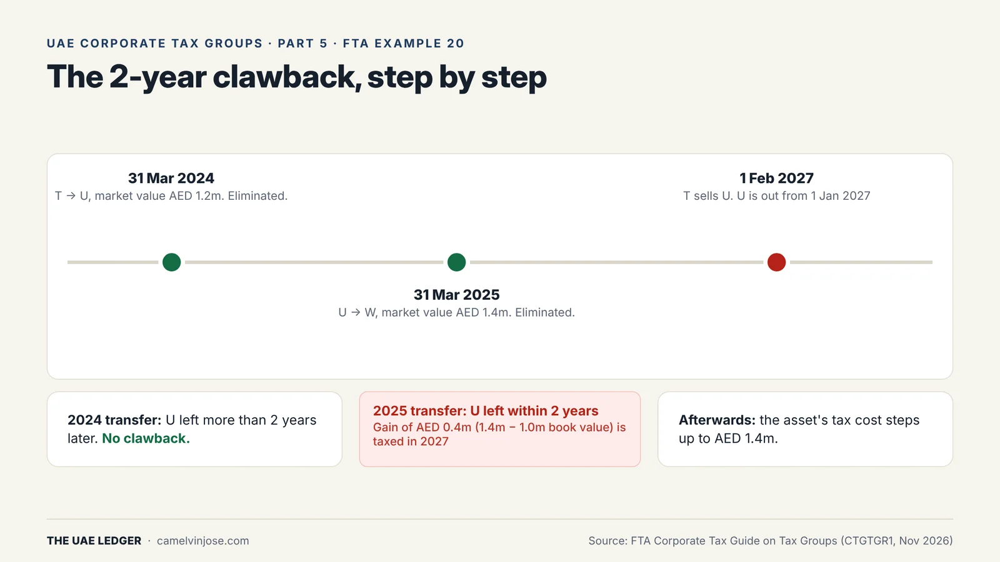
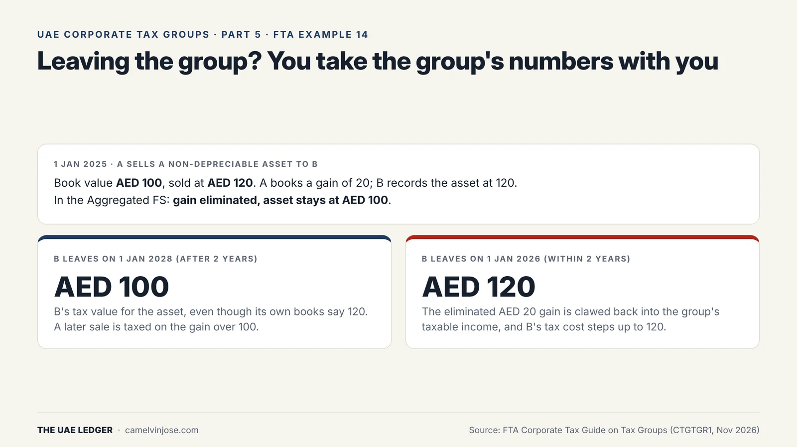
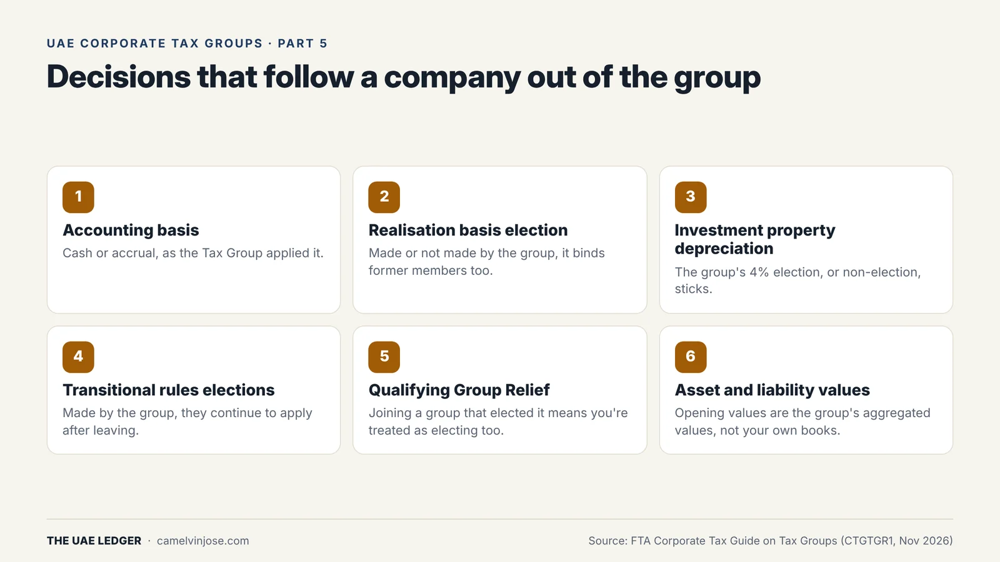

Inside a Tax Group, moving an asset from one company to another has no tax effect. The gain is eliminated on aggregation ([Part 4]()). That makes restructuring cheap, but only as long as both companies stay in the group.

This is Part 5.

### The rule

If either the **transferor or the transferee leaves the group within 2 years** of an intra-group transfer, the gain or loss that was eliminated is **brought back into tax**. It's measured at **market value at the date of the transfer** and taxed in the group on the date the company leaves.

**The exception:** no clawback if the gain would have been exempt or left out of tax anyway, for example under Qualifying Group Relief, Business Restructuring Relief or the Participation Exemption, and that relief wouldn't itself have been clawed back.

### FTA Example 20, step by step

{: width="1600" height="900" loading="lazy" decoding="async"}

T, U and W are in a Tax Group. The asset has a book value of AED 1m throughout.

1. **31 March 2024:** T transfers the asset to U (market value AED 1.2m). Eliminated.
2. **31 March 2025:** U transfers it to W (market value AED 1.4m). Eliminated.
3. **1 February 2027:** T sells U to a third party. U is out of the group **from 1 January 2027** ([Part 3]()).

**The result:**
- **2024 transfer:** U left more than 2 years after it. No clawback.
- **2025 transfer:** U left within 2 years. Qualifying Group Relief wouldn't have saved it, because U leaving the group within 2 years would have triggered that clawback too. Business Restructuring Relief didn't fit either: the transfer was for cash and U didn't cease to exist.
- So a gain of **AED 0.4m** (AED 1.4m − AED 1m) is taxed in the group's **2027** return, and the asset's tax cost **steps up to AED 1.4m**.

The later market value applies, not the original AED 1.2m, because the 2025 transfer is the one being clawed back. Note too that leaving from 1 January 2027 put U inside the 2-year window, even though the sale happened in February.

### Mergers inside the group

When a member merges into another member and ceases to exist, it leaves the group on that date. **FTA Example 13** shows two things:

- **The merger itself:** if it meets the conditions for Business Restructuring Relief, the merger gain isn't taxed.
- **Earlier transfers:** X had transferred an asset to Y a year earlier. X then leaving within 2 years would have clawed back Qualifying Group Relief, so that earlier gain **is** taxed, at its market value at the transfer date.

### Leaving? You take the group's values with you

{: width="1600" height="900" loading="lazy" decoding="async"}

In **FTA Example 14**, A sells B a non-depreciable asset for AED 120 when its book value is AED 100. In the Aggregated FS the gain is eliminated and the asset stays at **AED 100**.

- **B leaves after 2 years:** B has to use **AED 100** as the asset's tax value, even though its own books say 120. If B later sells it, the taxable gain is measured from 100.
- **B leaves within 2 years:** the AED 20 gain is clawed back into the group's income, and B's tax cost steps up to **AED 120**.

### Decisions that follow a company out of the group

{: width="1600" height="900" loading="lazy" decoding="async"}

Once a company joins, the group's choices become its choices, **including after it leaves**:

- **Accounting basis:** cash or accrual, as the group applied it.
- **Realisation basis election:** the company follows whatever the group decided, even if it had made the opposite choice before joining.
- **Investment property depreciation:** the group's election (or non-election) for the 4% annual tax depreciation on fair-valued investment properties applies to the joining company's properties too, and stays with them.
- **Transitional rule elections:** if the group made them, they keep applying to former members.
- **Qualifying Group Relief:** if any member has elected it, the whole group is treated as electing, and the election stays with members after they leave.

### Before you move assets around

- Keep an **intra-group transfer register**: date, asset, market value, transferor and transferee.
- Check the register **before** any sale of a member or exit from the group. Anything moved in the last 2 years is a possible tax charge.
- Where you can, structure transfers so that **Qualifying Group Relief or Business Restructuring Relief** would apply on their own terms. That's what switches the clawback off.

**[Next, Part 6]():** losses, interest and reliefs. What the group shares, what stays ring-fenced, and how pre-group losses get forfeited.
