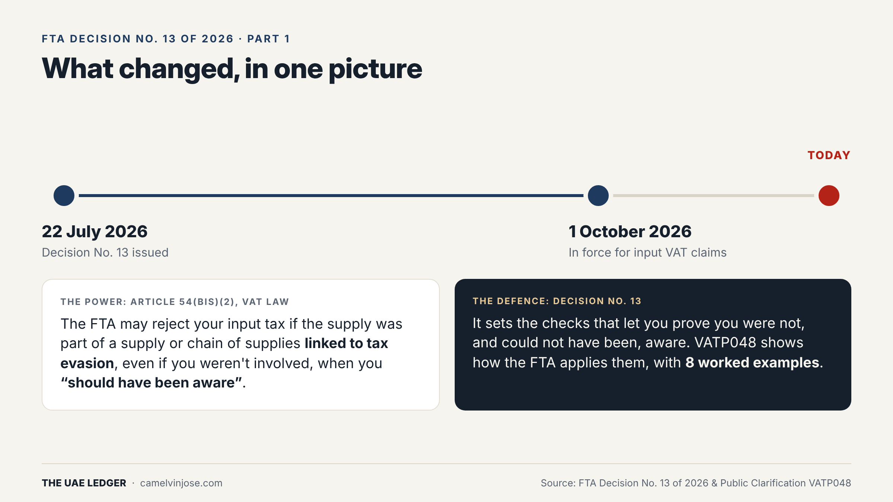
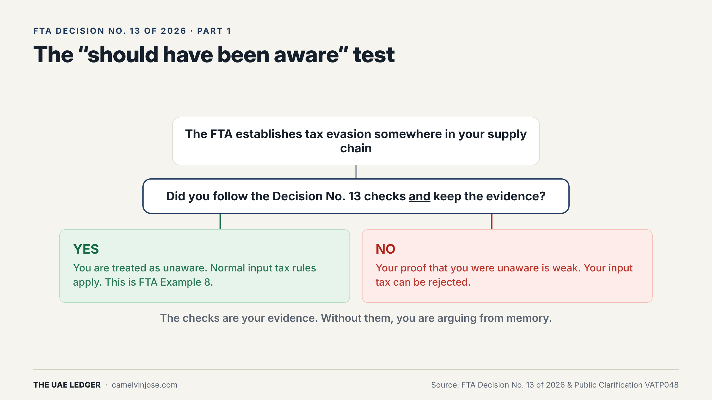
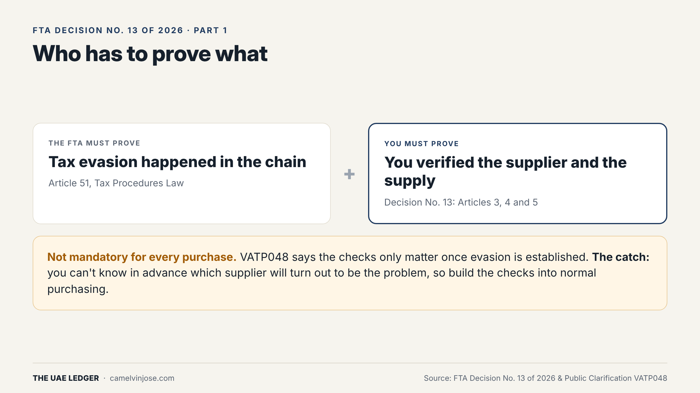

For years, the input VAT conversation in the UAE was simple: get a valid tax invoice, make sure the supplier's TRN is right, claim it.

That is no longer the whole story. Since **1 October 2026**, holding a valid tax invoice is the *starting point* for recovering input VAT. It is not the finish line.

This is Part 1 of a 5-part series on **FTA Decision No. 13 of 2026** and the FTA's **Public Clarification VATP048**. By the end of the series you will know every check the FTA expects, all eight worked examples it published, and what to do about it this quarter.

### What changed

Two pieces fit together:

- **Article 54(bis)(2) of the VAT Law** lets the FTA reject your input tax if the supply was part of a supply, or a chain of supplies, **linked to tax evasion**. This applies even if you were not involved, as long as you *"should have been aware"* of the link.
- **Decision No. 13 of 2026** (issued 22 July 2026, in force 1 October 2026) sets out the checks that let you prove you were not aware, and could not have been.

**VATP048** then explains how the FTA will apply those checks, using eight worked examples. We go through all eight in this series.

**The one-line version:** your input VAT claim is now only as clean as your supplier.

### The test that decides your claim

Strip away the legal language and the logic is a single question.

If the FTA establishes tax evasion somewhere in your supply chain, **did you follow the Decision No. 13 checks and keep the evidence?**

- **Yes:** you are treated as unaware. The normal input tax rules apply. This is exactly FTA Example 8, which we cover in Part 5.
- **No:** your ability to prove you were unaware is weak, and your input tax can be rejected.

The checks *are* your evidence. Without them, you are defending your claim from memory, and memory doesn't hold up well in a tax audit.

### Who has to prove what

This part is often misunderstood, in both directions.

- **The FTA carries the burden of proving tax evasion** (Article 51 of the Tax Procedures Law). It can't reject your claim just because a supplier looks odd.
- **You carry the burden of proving your verification.** Once evasion is established, it's on you to show what checks you ran.

And one more nuance: **the checks are not mandatory for every purchase.** VATP048 says you don't need to apply them to all supplies. The Decision only matters where the FTA has established evasion.

That sounds like relief. It isn't. You can't know in advance which of your suppliers will turn out to be part of an evasion chain. The only workable approach is to build the checks into normal purchasing, so the evidence already exists when you need it.

### What the checks look like

Decision No. 13 has three pillars:

1. **Verify the supplier** (Article 3): identity, place of business, risk indicators, plus a bank account and reputation check for large spend.
2. **Verify the supply** (Article 4): genuine commercial reason, payment conditions, price, licence scope, origin of goods, any intermediary's role.
3. **Document it** (Article 5): record every step, keep the supporting documents, and keep a written policy naming who runs the checks.

The rest of the series takes each pillar apart, with the FTA's own examples:

- **Part 2:** Who are you actually buying from? (supplier checks, Examples 1 to 3)
- **Part 3:** AED 10K, 100K, 375K: the numbers that set your checks
- **Part 4:** Too cheap, wrong licence, odd bank account (Examples 4 to 7)
- **Part 5:** If it isn't documented, it didn't happen (Example 8 and a 6-step action plan)

### What to do this week

Pull your top 20 suppliers by spend for the last 12 months. For each one, ask a single question: *if the FTA asked me today how I verified this supplier, what would I show them?*

If the honest answer is "the tax invoice," you have found your gap.
