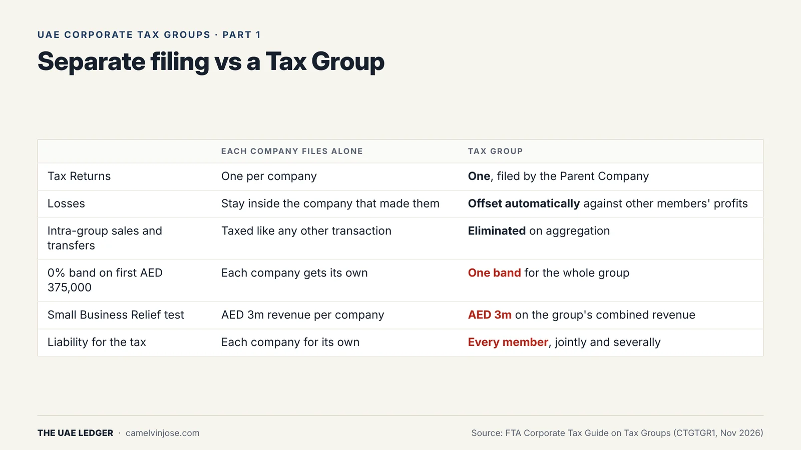
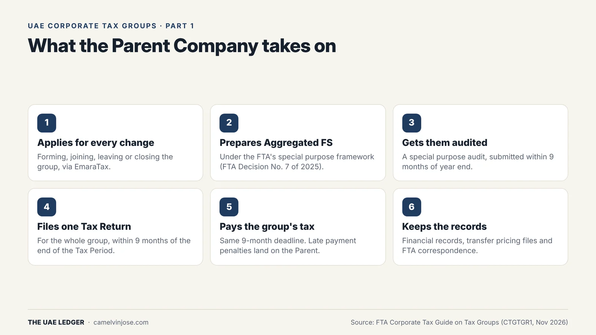
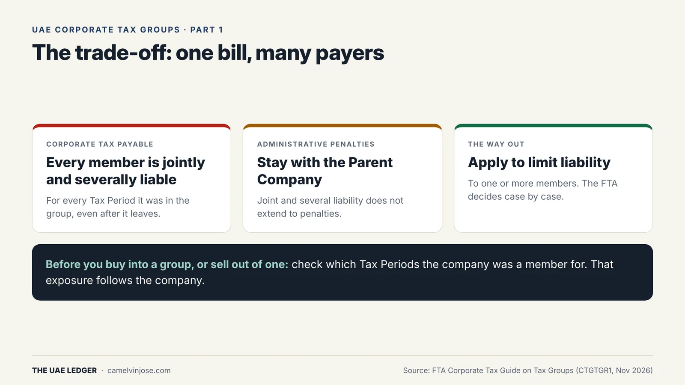

If you run two or more UAE companies under common ownership, you've probably been asked whether you should form a Tax Group. It sounds like pure admin relief: one return instead of five. It's more than that, in both directions.

This is Part 1 of a 6-part series based on the FTA's updated **Corporate Tax Guide on Tax Groups (CTGTGR1, November 2026)**. The series uses the FTA's own worked examples throughout.

### What a Tax Group is

A Tax Group is two or more UAE resident companies that the FTA treats as a **single Taxable Person** under Article 40 of the Corporate Tax Law. The Parent Company files one Tax Return for all of them, based on one set of **Aggregated Financial Statements**.

Three things to know up front:

- **It's optional.** A Tax Group only exists if the companies apply and the FTA approves.
- **It isn't a VAT group.** A Corporate Tax Group is a separate regime from a VAT tax group. Having one doesn't give you the other.
- **The businesses don't have to be related.** A trading company and a property company can group, as long as the ownership and other conditions are met (Part 2).

There's no cap on the number of members. Each company can be in only one Tax Group at a time, though, and a Parent Company can't split its subsidiaries into several groups.

### What you gain, and what you give up

{: width="1600" height="900" loading="lazy" decoding="async"}

**The gains:**
- **One Tax Return** and one payment, handled by the Parent Company.
- **Losses offset automatically.** A loss in one member reduces another member's profit in the same year, with no loss transfer paperwork.
- **Intra-group transactions are eliminated.** Management fees, intra-group sales and asset transfers between members drop out of the taxable result (subject to the 2-year clawback in Part 5).

**What you give up:**
- **One 0% band, not several.** The 0% rate applies to the first AED 375,000 of the *group's* Taxable Income, however many companies are in it. Five companies filing separately each get their own band.
- **Small Business Relief is tested on the group.** The AED 3 million revenue test applies to the group's combined revenue.
- **An extra audit.** The Aggregated Financial Statements need a special purpose audit every year (Part 4).

The decision usually comes down to whether the pooled losses and eliminated intra-group charges are worth more than the extra 0% bands you give up, plus the cost of the audit.

### What the Parent Company takes on

{: width="1600" height="900" loading="lazy" decoding="async"}

The Parent Company represents the group. It applies to form the group and for every later change, prepares and audits the Aggregated Financial Statements, files the single return and pays the tax within **9 months** of the year end, and keeps the records. That includes transfer pricing documentation.

Registration works like this:
- Every company needs its own Corporate Tax TRN **before** applying.
- Once the FTA approves, the group gets a **separate TRN**.
- Members are **not deregistered**. They keep their own TRNs, which they'll need again if they ever leave.

### The trade-off nobody mentions: joint liability

{: width="1600" height="900" loading="lazy" decoding="async"}

This is the part that should change how you think about grouping:

- **Every member is jointly and severally liable** for the group's Corporate Tax, for every Tax Period it was a member. That liability stays with the company **after it leaves** the group.
- **Administrative penalties are different.** They stay with the Parent Company, because joint and several liability doesn't extend to penalties.
- **You can apply to limit it.** A Tax Group can ask the FTA to limit joint and several liability to one or more members. The FTA decides case by case.

**Why this matters in a deal:** if you're buying a company that has ever been in a Tax Group, the group's unpaid tax for those years is a liability of the company you're buying. Put it on the due diligence checklist.

### Should you form one?

It's usually worth a serious look when:
- one company makes losses (a start-up arm, a new branch) and another makes steady profits,
- there are significant intra-group charges or asset transfers, or
- the group is already preparing IFRS accounts for every entity anyway.

It's usually not worth it when:
- each company's profit sits under AED 375,000, so separate filing gives you several 0% bands,
- a key company is a Qualifying Free Zone Person (it can't join; Part 2), or
- a member has minority shareholders or its own lenders who won't accept it carrying the rest of the group's tax.

**[Next, Part 2]():** the nine conditions, and the ownership traps in the FTA's examples that stop companies grouping.
