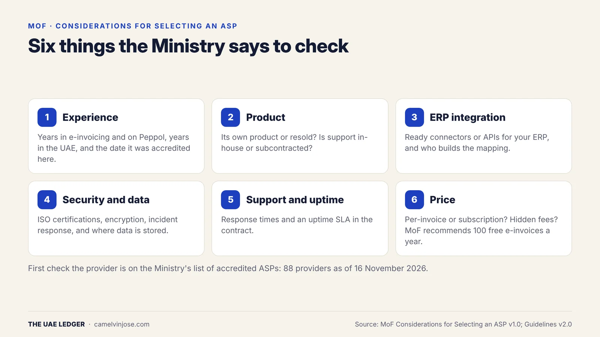
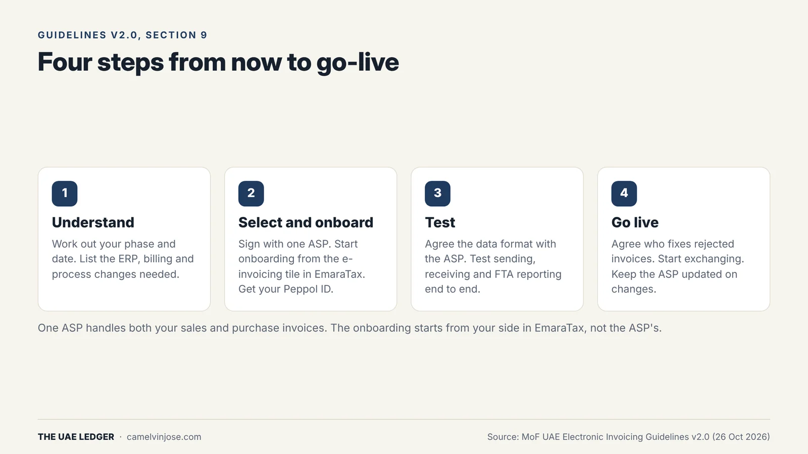

Every business in scope needs an **Accredited Service Provider (ASP)**: the company that sends, receives and reports your e-invoices. As of 16 November 2026, the Ministry of Finance lists **88 accredited ASPs**, and most of them will tell you they're the right choice.

The Ministry has published its own guidance on what to look at. Here it is, turned into questions to ask, plus the contract points it doesn't cover.

### The ground rules

- **One ASP, both directions.** You appoint a single ASP for sending (sales) and receiving (purchases). You can't split them.
- **Group companies can differ.** Each member of a VAT Tax Group can use a different ASP, but most groups standardise on one.
- **Accredited only.** Check the provider is on the Ministry's [list of accredited ASPs](https://mof.gov.ae/en/about-ministry/mof-initiatives/einvoicing/pre-approved-einvoicing-service-providers), and note its accreditation number. Some providers' marketing still refers to an earlier "pre-approved" stage.
- **You start onboarding.** Onboarding begins from the **e-invoicing tile in EmaraTax**, not from the ASP's side.
- **Phase 1 is already late.** Businesses with revenue of AED 50 million or more had to appoint by **30 October 2026**. Smaller businesses have until **31 March 2027**. ([Which phase are you in?]())

### Six things the Ministry says to check

{: width="1600" height="900" loading="lazy" decoding="async"}

**1. Experience.** How long has it provided e-invoicing, and how long has it been on Peppol? How long has it operated in the UAE, and when was it accredited here? A provider that has run e-invoicing in other countries has already dealt with problems that a new entrant hasn't met yet.

**2. Product.** Is the platform its own, or a resold third-party product? Is support in-house or subcontracted? If it's resold, find out who you call when something breaks at month-end.

**3. ERP integration.** Does it have a ready connector for your ERP, or will someone build a custom integration? Who does the field mapping, and is that in the price? This is where most projects slip.

**4. Security and data.** Which certifications does it hold (ISO and others)? How is data encrypted, and what's its incident response? **Where is your data stored**, in the UAE or overseas?

**5. Support and uptime.** What are the response times, and is there an uptime commitment written into the contract?

**6. Price.** Per-invoice or subscription? Are there set-up, integration or archive fees? The Ministry recommends that contracts include **100 free e-invoices a year**. Ask whether yours does.

### Contract points the guidance doesn't spell out

These come from how the rules work, not from the Ministry's checklist:

- **Archive and exit.** [Ministerial Decision No. 197 of 2026]() requires you to keep e-invoice data for the full Tax Procedures Law period: generally **5 years**, and longer in some cases, such as real estate. You can hand storage to the ASP, but **the legal obligation stays with you**. The contract should give you full data export in a readable format, during the contract and after it ends.
- **Switching.** The guidelines don't describe a switching process, so put notice periods, data handover and parallel running into the contract yourself.
- **Rejections.** Agree in writing who monitors failed invoices, how you're told, and how fast fixes happen. The 14-business-day issuing deadline doesn't stop while an invoice sits in an error queue.
- **Data-change notices.** Not telling your ASP about changes to your FTA-registered details costs [AED 250 a day](). Make it part of your licence-renewal checklist.

### Four steps to go-live

{: width="1600" height="900" loading="lazy" decoding="async"}

The guidelines set out the path:

1. **Understand.** Confirm your phase and date. List the changes needed in your ERP, billing and approval processes.
2. **Select and onboard.** Sign with one ASP, onboard through EmaraTax, and get your Peppol Participant Identifier (0235 followed by your TIN).
3. **Test.** Agree the data format with the ASP, then test sending, receiving and FTA reporting end to end with real invoice scenarios: credit notes, advances, foreign currency, zero-rated sales.
4. **Go live.** Agree roles for monitoring and error fixing, start exchanging, and keep the ASP updated when your details change.

### A practical shortlist method

- Start with 3 providers that already connect to **your** ERP.
- Ask each for a live demo using **your own** invoices, including a credit note and an advance-payment invoice.
- Ask for 2 UAE client references of your size.
- Compare the **total 3-year cost**, not the per-invoice price.

**Sources:** [Considerations for Selecting an Accredited Service Provider v1.0](https://mof.gov.ae/wp-content/uploads/2026/02/Considerations-for-selecting-an-Accredited-Service-Provider_V-1.0-23Feb2024.pdf) (Ministry of Finance, 23 February 2026); [UAE Electronic Invoicing Guidelines v2.0](https://mof.gov.ae/wp-content/uploads/2026/10/UAE-Electronic-Invoicing-Guidelines_En.pdf), Sections 5.4, 6.1, 9 and Appendix 1; [MoF list of accredited ASPs](https://mof.gov.ae/en/about-ministry/mof-initiatives/einvoicing/pre-approved-einvoicing-service-providers) (checked 16 November 2026).
