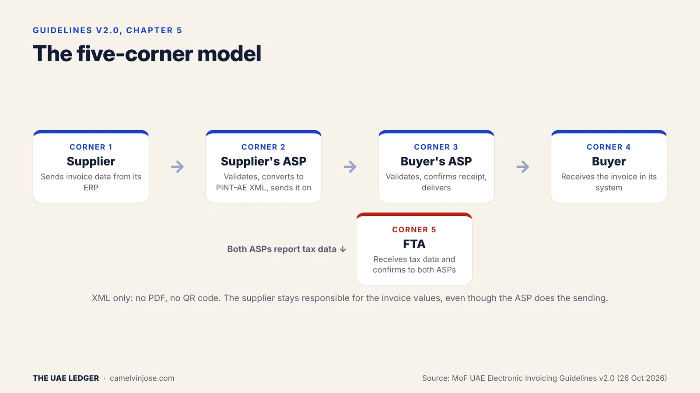
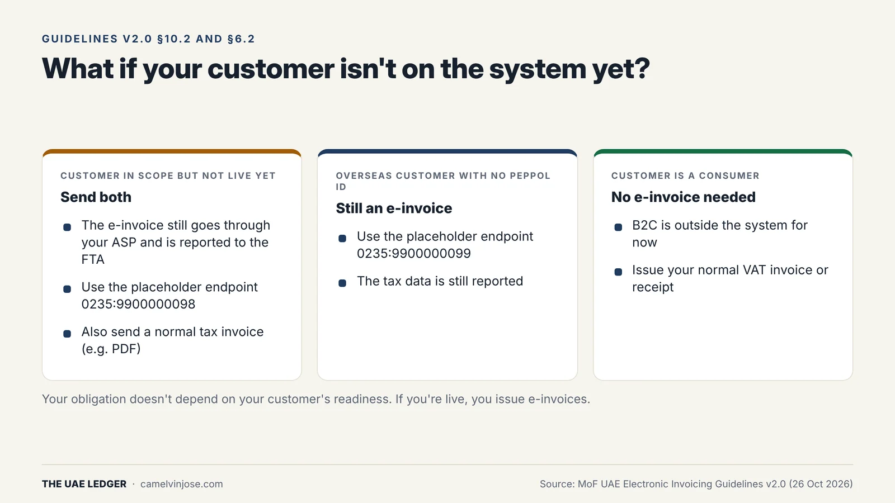

From go-live, emailing a PDF doesn't count as issuing an invoice. The invoice has to travel as structured data through two service providers, with the tax data reported to the FTA on the way. Here's how that works, based on the Ministry of Finance's **Electronic Invoicing Guidelines v2.0**.

### The five corners

{: width="1600" height="900" loading="lazy" decoding="async"}

1. **You (the supplier)** send the invoice data from your ERP or billing system to your ASP, in a format you've agreed with them.
2. **Your ASP** validates the data and converts it into the UAE standard, **PINT-AE XML**. It also generates the invoice's unique ID (UUID).
3. **Your ASP** sends the invoice over the Peppol network to **your customer's ASP**, and at the same time reports the tax data to the **FTA**.
4. **Your customer's ASP** validates the invoice, confirms receipt and delivers it to **your customer**.
5. **The FTA** confirms the tax data to both ASPs, and each ASP passes the confirmation back to its client.

If the invoice fails validation at your customer's ASP, that ASP tells your ASP and the FTA. The failure comes back to you to fix.

Two things to take from this:

- **You stay responsible.** The ASP does the sending, but the guidelines are clear that the obligation remains with the supplier. You calculate every value on the invoice. A wrong VAT figure is your error, not your ASP's.
- **There's no PDF and no QR code.** The legal e-invoice is the XML. You can still send a PDF copy for convenience, but it doesn't replace the e-invoice.

### Your Peppol address

Every business on the system gets a **Participant Identifier**: **0235** followed by its 10-digit **TIN**, the first 10 digits of its TRN. That's the address invoices are sent to. Each member of a VAT group has its own TIN and identifier, based on its own TRN, not the group representative's.

### What an e-invoice has to contain

The Ministry's mandatory fields list sets out **51 mandatory fields** under PINT-AE, plus conditional ones. The data falls into a few groups:

- **Header:** invoice number, issue date, invoice type code, currency, due date, UUID.
- **Seller and buyer:** name, TRN (or TIN if not VAT-registered), legal registration details and issuing authority, address, electronic address.
- **Lines:** item name, quantity, unit of measure, unit price, discounts and charges, VAT category, rate and amount, and whether it's goods or services.
- **Totals and VAT breakdown:** net, VAT and gross totals, amounts already paid, amount payable, and VAT by category.

Some points from the clarifications in v2.0:

- A **VAT-registered** seller puts its **15-digit TRN** in the VAT number field. A seller that **isn't VAT-registered** uses its **10-digit TIN** in a different field. A Corporate Tax TRN must never go in the VAT field.
- **Advance payments:** issue a tax invoice when the advance is received. The final invoice covers only the balance and refers back to the advance invoice.
- **Credit notes:** one credit note can cover several invoices, and it can be partial. A negative invoice must be issued as a credit note.
- **Invoice type code 480** is for supplies entirely outside the scope of UAE VAT.
- **HSN codes** are optional for now. The Ministry will announce when they become mandatory.
- **You can't add your own fields** to PINT-AE.

The practical point: **most ERPs don't capture all of this today**, especially buyer legal registration details. That data gap is usually the biggest piece of work in a project, not the connection to the ASP.

### When your customer isn't ready

{: width="1600" height="900" loading="lazy" decoding="async"}

Phases go live at different times, so you'll often be live before some customers are. Your obligation doesn't depend on theirs.

- **The customer is in scope but not live yet:** you still issue the e-invoice through your ASP, using the placeholder endpoint **0235:9900000098**, and the tax data is reported. You **also** send a normal tax invoice, such as a PDF, so they can recover input VAT.
- **An overseas customer with no Peppol ID:** you still issue an e-invoice, using the placeholder endpoint **0235:9900000099**.
- **A consumer:** no e-invoice. B2C is outside the system for now.

### Timing

The decisions require e-invoices and credit notes to be issued and transmitted **within 14 business days** of the transaction. VAT timing rules still apply alongside that. [Ministerial Decision No. 197 of 2026]() has the detail.

### What to do now

- **Map your invoice data** against the mandatory fields, and fix the gaps at source in your customer master.
- **Collect customers' TRNs and TINs** now, rather than at go-live.
- **Agree a rejection process** with your ASP: who sees the failure, who fixes it, and how fast.
- **Keep sending PDF tax invoices** to customers who aren't live yet.

**Sources:** [UAE Electronic Invoicing Guidelines v2.0](https://mof.gov.ae/wp-content/uploads/2026/10/UAE-Electronic-Invoicing-Guidelines_En.pdf) (Ministry of Finance, 26 October 2026), Chapter 5, Sections 2, 3, 6, 10 and 12, and Appendix 6; [UAE Electronic Invoice Mandatory Fields v1.0](https://mof.gov.ae/wp-content/uploads/2026/02/UAE-Electronic-Invoice-mandatory-fields_V-1.0-23Feb2026.pdf).
