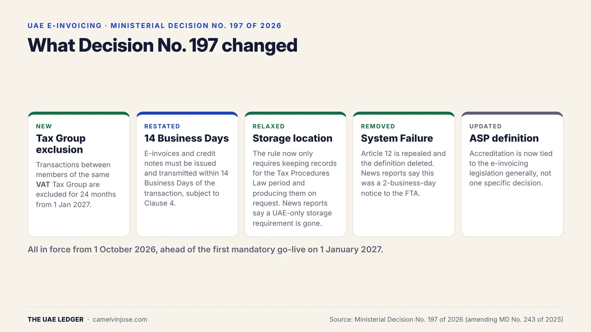
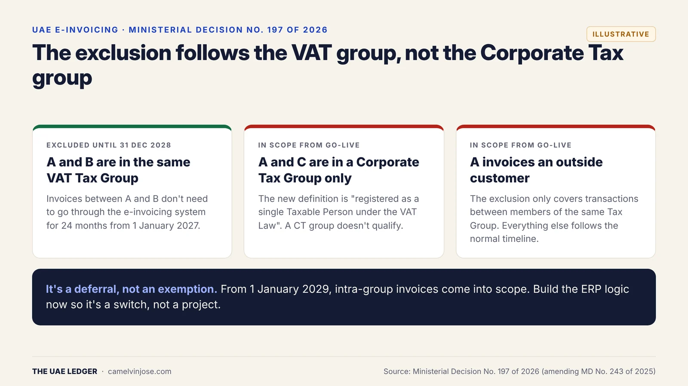
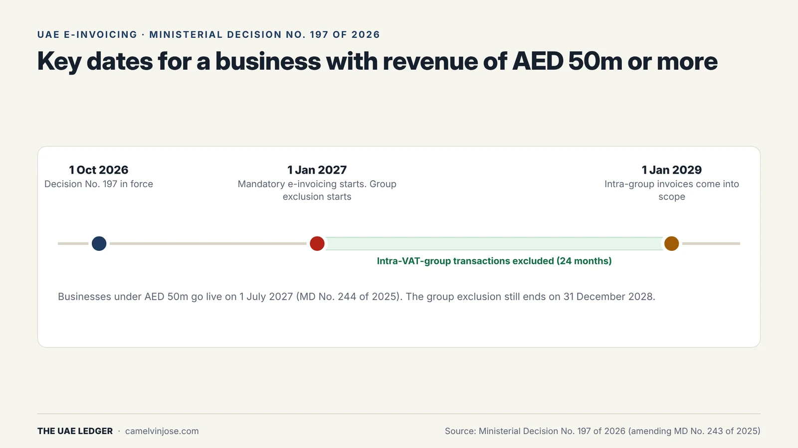

Six weeks before mandatory e-invoicing starts, the Ministry of Finance has changed some of the rules. **Ministerial Decision No. 197 of 2026** amends Ministerial Decision No. 243 of 2025, the main e-invoicing decision. It has been in force since **1 October 2026** and was announced on 19 October.

Most of it makes life easier. One part, the new Tax Group exclusion, is narrower than the headlines suggest.

### The five changes at a glance

{: width="1600" height="900" loading="lazy" decoding="async"}

1. **Tax Group exclusion (new).** Transactions between members of the same Tax Group are Excluded Transactions for **24 months from 1 January 2027**.
2. **Deadline to issue and transmit.** E-invoices and e-credit notes must be issued and transmitted through the system **within 14 Business Days** from the Date of Business Transaction. This is subject to Clause 4 of Article 6.
3. **Data storage.** The new Article 11 only requires you to keep e-invoices, credit notes and related data for the period set in the **Tax Procedures Law**, and to be able to produce them to the FTA on request. It says nothing about where the data must be kept. Ministry and press coverage say the earlier rule required storage within the UAE.
4. **System Failure.** Article 12 is **repealed** and the "System Failure" definition deleted. That removes the requirement, reported in the coverage, to notify the FTA of a system failure within two business days.
5. **Accredited Service Provider.** Accreditation is now defined by reference to "the legislation regulating the Electronic Invoicing System" in general, rather than one specific decision.

The decision also adds two definitions, **Tax Group** and **Taxable Person**, both tied to the VAT Law. The first is the one that matters.

### The exclusion follows the VAT group, not the Corporate Tax group

{: width="1600" height="900" loading="lazy" decoding="async"}

The decision defines a Tax Group as *"two or more Persons registered with the Authority for Tax purposes as a single Taxable Person in accordance with the provisions of the VAT Law."* That's a **VAT** group.

A **Corporate Tax Group** is a separate registration with separate conditions (see [what a Corporate Tax Group is]()). Many groups have one and not the other. So:

- **A and B are in the same VAT Tax Group:** invoices between them are excluded until 31 December 2028.
- **A and C are in a Corporate Tax Group but not a VAT group:** their invoices are **in scope** from go-live.
- **A invoices a related company outside its VAT group, or any outside customer:** **in scope**, on the normal timeline.

If your ERP project team has been told "intra-group is out", check which group they mean.

### It's a deferral, not an exemption

{: width="1600" height="900" loading="lazy" decoding="async"}

The exclusion runs for 24 months from **1 January 2027**, whatever your go-live date. Intra-VAT-group transactions come into scope on **1 January 2029**.

For a business with revenue of AED 50 million or more, that's two years after its own go-live. A smaller business that goes live on 1 July 2027 gets 18 months.

Two practical points:

- **Build the logic now.** Your ERP needs to flag intra-VAT-group invoices and route them differently. If that flag can be switched off in 2029, the change is configuration, not a new project.
- **You can opt in.** Clause 3 of the new Article 4 lets you issue and exchange e-invoices voluntarily for Excluded Transactions. If you do, the rules apply to you in full, **except the penalty provisions**. That makes it a low-risk way to test intra-group invoicing before it becomes mandatory.

### The other changes, in practice

**The 14-business-day deadline.** Count it in business days and build it into your billing cut-off. Clause 4 of Article 6 still applies, so where the VAT Law has its own timing rules, check those too. Don't treat 14 business days as a blanket extension.

**Storage.** Moving your e-invoice archive outside the UAE no longer seems to break a location rule. The obligation now is **retention and production**: keep the data for the full Tax Procedures Law period and make sure you can hand it over when the FTA asks. If your provider or ERP host is overseas, check your contract gives you guaranteed access and export of the data for that whole period.

**System failures.** There's no longer a notice to file within two business days. But the deadline to issue and transmit hasn't moved. An outage doesn't stop the 14-day clock. Keep your own outage log and a plan for catching up.

### Unchanged, but worth repeating

The other exclusions in Article 4 stay as they were:
- sovereign government activities that don't compete with the private sector,
- international passenger air transport with an electronic ticket, and ancillary services with an Electronic Miscellaneous Document,
- international air cargo with an Airway Bill, for 24 months from the system's effective date,
- VAT-exempt and zero-rated financial services under Article 42 of the VAT Executive Regulation,
- anything else the Minister specifies.

### What to do this month

- **Map your groups.** List which entities are in a **VAT** Tax Group, and don't use the Corporate Tax Group list for this. Only those entities' transactions with each other are excluded.
- **Tag intra-group invoices** in the ERP so you can exclude them now and bring them into scope in 2029.
- **Decide whether to opt in** for intra-group invoices early, to test before 2029.
- **Set billing controls** for the 14-business-day issue-and-transmit deadline.
- **Review your archive contract** with your Accredited Service Provider or ERP host for retention period, access and export.

**Source:** [Ministerial Decision No. 197 of 2026](https://mof.gov.ae/wp-content/uploads/2026/10/Ministerial-Decision-No.-197-of-2026-–-Amending-Certain-Provisions-of-Ministerial-Decision-No.-243-of-2025-on-the-Electronic-Invoicing-System_En.pdf) (Ministry of Finance), amending Ministerial Decision No. 243 of 2025 on the Electronic Invoicing System.
