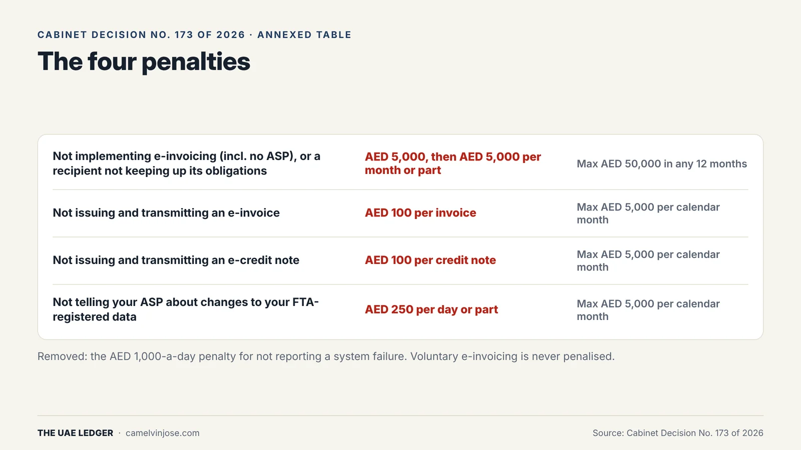
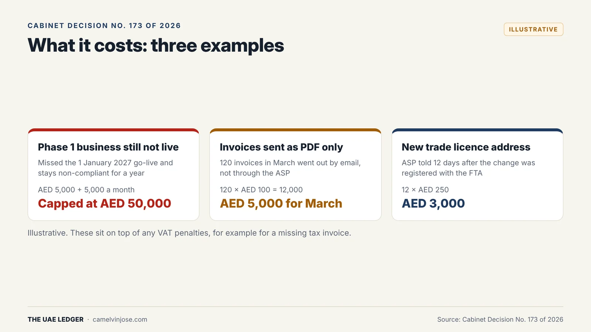

On 30 October 2026, the Ministry of Finance announced **Cabinet Decision No. 173 of 2026**, a new penalty table for e-invoicing. It **repeals Cabinet Decision No. 106 of 2025**, so the figures still quoted in many articles are out of date.

Overall it's softer. But one penalty now also applies to recipients, and the largest one still starts the day you miss your date.

### The four penalties

{: width="1600" height="900" loading="lazy" decoding="async"}

| Violation | Penalty | Cap |
|---|---|---|
| Not implementing e-invoicing under Ministerial Decision No. 244, **including not appointing an ASP**; or a recipient that has implemented but doesn't keep up its recipient obligations | AED 5,000 for the first instance, then AED 5,000 for each month or part of a month it continues | AED 50,000 in any 12 consecutive months |
| Not issuing and transmitting an e-invoice to the recipient through the system | AED 100 per e-invoice | AED 5,000 per calendar month |
| Not issuing and transmitting an e-credit note | AED 100 per credit note | AED 5,000 per calendar month |
| Not telling your ASP about changes to your data registered with the FTA | AED 250 per day or part of a day | AED 5,000 per calendar month |

The decision takes effect the day after it's published in the Official Gazette.

### What changed from Decision No. 106 of 2025

- **The implementation penalty is now capped** at AED 50,000 in any 12 months. Under the old table it ran at AED 5,000 a month with no overall cap.
- **Recipients are now covered.** The implementation penalty applies to an issuer **or** a recipient that fails to implement. It also catches a recipient that went live but stopped meeting its obligations.
- **The data-change penalty is lower.** It drops from AED 1,000 a day to **AED 250 a day**, with a monthly cap of AED 5,000.
- **The system-failure penalty is gone.** The AED 1,000-a-day penalty for not reporting a system failure has been removed, in line with [Ministerial Decision No. 197](), which repealed the duty to report.
- **No double penalties.** If the same person is both issuer and recipient for the same violation, only one penalty applies.

What hasn't changed: **voluntary e-invoicing is never penalised.** If you go live before your mandatory date, mistakes made before that date don't attract these penalties.

### What it costs in practice

{: width="1600" height="900" loading="lazy" decoding="async"}

**A Phase 1 business that isn't live on 1 January 2027.** AED 5,000 for the first instance, then AED 5,000 for each month or part of a month it stays non-compliant. On those figures it reaches the **AED 50,000 cap** after about nine more months. The cap applies to any 12-month period, so it isn't a one-off.

**Invoices emailed as PDFs instead of going through the ASP.** 120 invoices in March at AED 100 each is AED 12,000. That's capped at **AED 5,000 for March**, and the cap resets each calendar month.

**A trade licence change not passed to the ASP.** Told 12 days late: 12 × AED 250 = **AED 3,000**.

These sit **on top of** ordinary VAT penalties. If an invoice wasn't issued properly, the VAT questions (output tax timing, your customer's input tax claim) still apply under the VAT rules. For those, see the [penalty calculator]({{ '/penalty-calculator/' | relative_url }}).

### Where the risk really is

The per-invoice penalties are capped at AED 5,000 a month, which a large business could almost ignore. The bigger cost is commercial. If your invoices don't arrive through the system, your **customers' accounts payable teams may not process them**, and that delays your cash.

The penalty that matters most is the first one. **Not having an ASP** counts as failing to implement. For Phase 1 businesses, the appointment deadline was 30 October 2026.

### What to do now

- **Phase 1:** confirm your ASP contract is signed and onboarding has started in EmaraTax. Go-live is 1 January 2027.
- **Phase 2:** put 31 March 2027 (ASP) and 1 July 2027 (go-live) on the board calendar.
- **Make ASP notification a routine step** whenever your licence, address, legal name or other registered details change.
- **Consider going live early.** Voluntary e-invoicing can't be penalised, so it's a free test run.

**Sources:** [Cabinet Decision No. 173 of 2026](https://mof.gov.ae/wp-content/uploads/2026/10/Cabinet-Decision-No.-173-of-2026-On-the-Violations-and-Administrative-Penalties-Resulting-from-Violation-of-the-Legislation-Regulating-the-Electronic-Invoicing-System_En.pdf) on violations and administrative penalties under the e-invoicing legislation (Ministry of Finance), Articles 2 to 5 and the annexed table; [UAE Electronic Invoicing Guidelines v2.0](https://mof.gov.ae/wp-content/uploads/2026/10/UAE-Electronic-Invoicing-Guidelines_En.pdf), Chapter 11.
