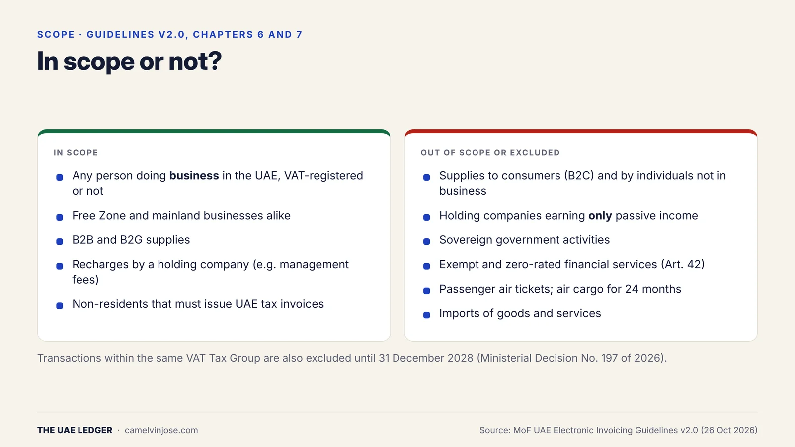
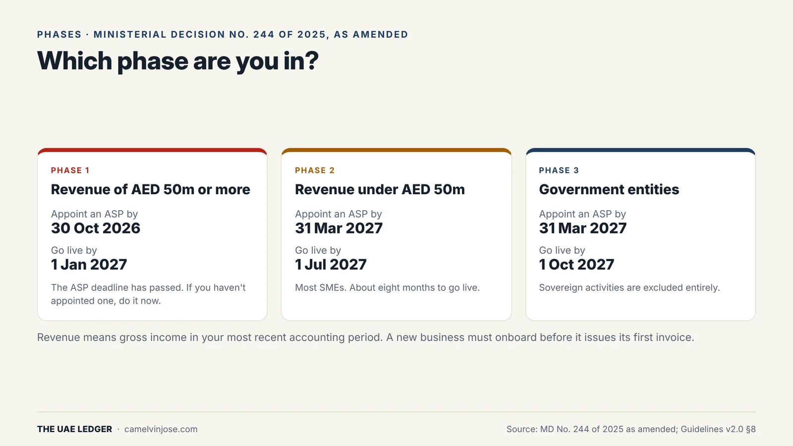

The question I hear most about e-invoicing is "does this even apply to us?" Usually it comes from businesses that aren't VAT registered, or that only invoice group companies. The Ministry of Finance answered most of it in **version 2.0 of the UAE Electronic Invoicing Guidelines**, published on 26 October 2026.

Short answer: if you do business in the UAE, assume you're in scope until you find a specific exclusion.

### Who is in scope

{: width="1600" height="900" loading="lazy" decoding="async"}

E-invoicing applies to any person doing **business** in the UAE, **regardless of VAT registration**. That's the point most people miss. A business below the VAT threshold, or one making only exempt supplies, still has to issue e-invoices for its business-to-business sales.

A few cases the guidelines settle:

- **Free Zone businesses** are not carved out. They follow the same rules as mainland businesses.
- **Holding companies** earning only passive income (dividends, interest) with no business transactions are out of scope. But if the holding company **recharges** costs to subsidiaries or anyone else, such as management fees, those recharges are business transactions and need e-invoices.
- **Non-residents** that must issue UAE tax invoices under the VAT law must issue them as e-invoices.
- **Businesses with no VAT registration** need a **Tax Identification Number (TIN)**, the 10-digit number at the start of a TRN. If you're not registered for any tax, you generate one through EmaraTax.

### What is excluded

- **Supplies to consumers (B2C)**, and sales by individuals who aren't in business. You keep issuing normal VAT invoices or receipts to consumers.
- **Sovereign government activities** that don't compete with the private sector.
- **International passenger air transport** with an electronic ticket, and related services documented on an Electronic Miscellaneous Document.
- **International air cargo** with an airway bill, for 24 months.
- **Exempt and zero-rated financial services** under Article 42 of the VAT Executive Regulation. Standard-rated financial services to UAE customers stay in scope.
- **Imports** of goods and services.
- **Transactions within the same VAT Tax Group**, until 31 December 2028. This is the [Ministerial Decision No. 197 exclusion](), and it covers VAT groups only, not Corporate Tax groups.

One trap: the FTA's existing administrative exceptions for tax invoices (for example, approvals to issue simplified invoices) **don't carry over** to e-invoices.

### Which phase you're in

{: width="1600" height="900" loading="lazy" decoding="async"}

| | Appoint an ASP by | Go live by |
|---|---|---|
| Revenue of AED 50 million or more | 30 October 2026 | 1 January 2027 |
| Revenue under AED 50 million | 31 March 2027 | 1 July 2027 |
| Government entities | 31 March 2027 | 1 October 2027 |

**How revenue is measured.** The guidelines define revenue as **gross income in your most recent accounting period**, based on your financial statements, or other documents acceptable to the FTA if there are none. They don't say whether revenue is added up across a group, so test each entity on its own figures. If a group member is near the line, get advice rather than guessing.

**New businesses.** A business set up after these dates doesn't get a grace period. It must appoint an ASP and finish onboarding **before it issues its first invoice**, and that first invoice must be an e-invoice.

**Going early.** Anyone can start voluntarily before their date. Voluntary e-invoices must meet the full technical rules, but [penalties]() only apply from your mandatory date.

### If you're a Phase 1 business

The deadline to appoint an ASP was **30 October 2026**, and go-live is about six weeks away. If you haven't appointed one, that's the first job this week. Not having an ASP falls within the "failure to implement" penalty, which starts at AED 5,000.

### What to do now

- **Confirm your phase** using revenue in your latest financial statements, entity by entity.
- **Check for exclusions** line by line. Most businesses have at least some sales in scope.
- **Get a TIN** for any in-scope entity without a TRN.
- **List intra-VAT-group flows** separately, since they're deferred, not exempt.
- **Pick your ASP.** Here's [what to check before you sign]().

**Sources:** [UAE Electronic Invoicing Guidelines v2.0](https://mof.gov.ae/wp-content/uploads/2026/10/UAE-Electronic-Invoicing-Guidelines_En.pdf) (Ministry of Finance, 26 October 2026), Chapters 6 to 8; Ministerial Decision No. 244 of 2025 as amended.
