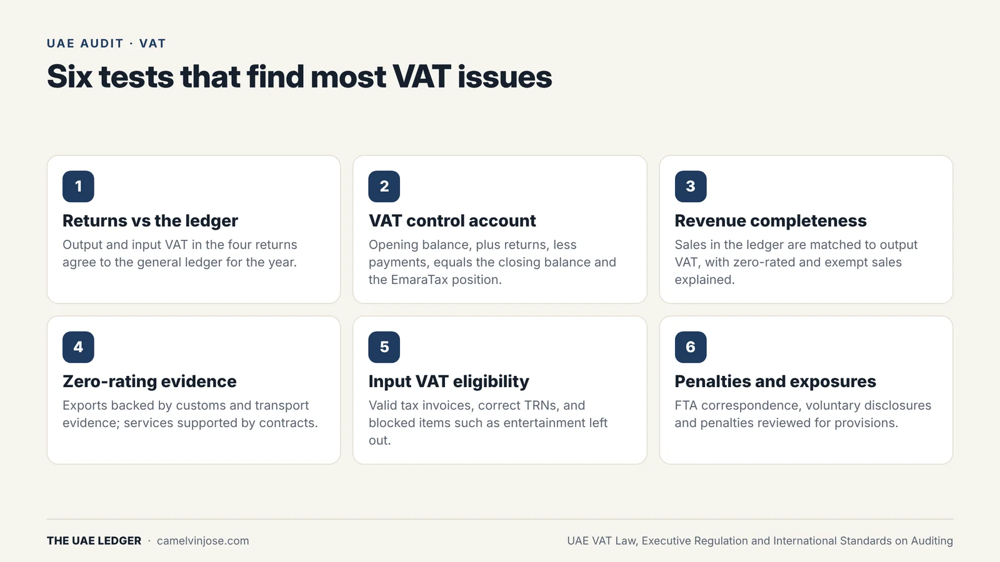
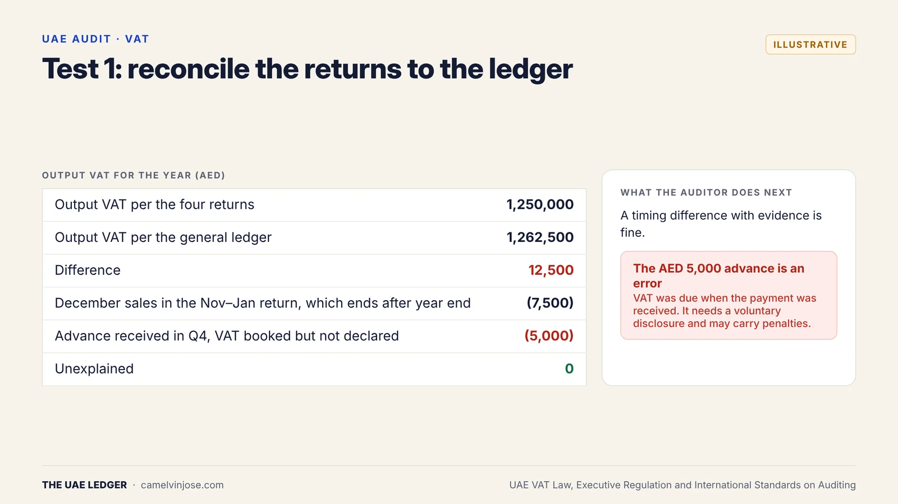
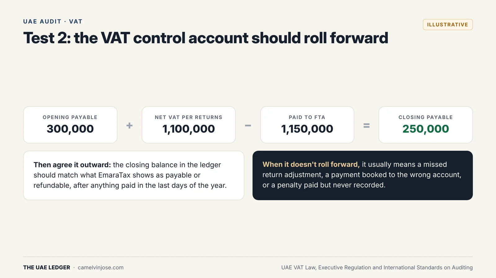

A statutory audit isn't a VAT audit. But VAT runs through almost every balance an auditor tests: revenue, purchases, payables, cash and provisions. So most year-end audits in the UAE end up looking hard at your VAT position.

Below are the six checks that find most of the issues, why each one matters, and what to have ready before fieldwork starts.

### Why your auditor cares about VAT at all

The auditor's job is to give an opinion on your financial statements. VAT affects them in three ways:

- **The VAT payable or refundable balance** is a liability or an asset on your balance sheet. It has to exist, be complete and be correctly valued.
- **Errors in VAT usually mean errors in revenue or expenses.** Output VAT that doesn't match sales often points to sales that are missing or misclassified.
- **Unreported mistakes mean penalties.** Under the auditing standards, the auditor has to consider whether you're complying with laws that affect the financial statements, and whether you need a provision for penalties.

### The six checks

{: width="1600" height="900" loading="lazy" decoding="async"}

#### 1. Do the returns agree to the ledger?

The auditor adds up output and input VAT from the returns covering your financial year and compares them with the general ledger. Every difference needs an explanation.

{: width="1600" height="900" loading="lazy" decoding="async"}

Some differences are just **timing**. If your VAT quarters don't line up with your financial year, a return can straddle the year end. That's fine as long as you can show it.

Others are **errors**. A common one is VAT booked on an advance payment but left out of the return. Under the VAT Law, the date of supply can be the date the payment is received, so the VAT was due then. That needs a voluntary disclosure and may attract penalties.

**From my audits:** one of the most common differences doesn't show up in the VAT ledger at all. **Bank credits for the year don't match the revenue reported in the VAT returns.** Some of the gap usually has a good reason, such as loans received, capital introduced, transfers between the company's own accounts, or refunds. Whatever is left after those is revenue the auditor has to chase, and VAT that may be missing from the returns. Run this check yourself before the auditor does. Banks now run it too: see [the case of a bank that compared VAT returns with bank credits]().

#### 2. Does the VAT control account roll forward?

{: width="1600" height="900" loading="lazy" decoding="async"}

Opening balance, plus net VAT from the returns, less payments to the FTA, should equal the closing balance. That closing balance should then agree with what EmaraTax shows, after any payments made in the last days of the year.

When it doesn't, the usual causes are:
- an adjustment in a return that was never booked in the ledger,
- a payment posted to the wrong account, or
- a penalty paid but never recorded.

#### 3. Is all revenue in the VAT returns?

The auditor goes the other way too: from the sales ledger to the returns. Standard-rated sales should carry 5% output VAT. Zero-rated and exempt sales should be identified and explained. Gaps here usually point to revenue recorded outside the main sales cycle, such as other income, asset disposals or recharges to related parties.

#### 4. Is zero-rating supported?

Zero-rated exports are where VAT savings turn into exposures. For exports of goods, the Executive Regulation requires official and commercial evidence of export within **90 days** of the date of supply. The auditor will sample exports and ask for:
- customs exit documents,
- bills of lading or airway bills, and
- for services, contracts showing where the customer is and where the service is used.

If the evidence is missing, the sale may be standard-rated, and the 5% becomes your cost.

#### 5. Is the input VAT recoverable?

The auditor samples input VAT and checks for:
- **a valid tax invoice**, with the supplier's TRN verified,
- **business use**, and
- **blocked items**. Under Article 53 of the Executive Regulation, these include entertainment for people other than employees, motor vehicles available for personal use, and goods or services for employees' personal use.

From 1 October 2026, this check goes further. Under [FTA Decision No. 13 of 2026](), a valid invoice may not be enough if the supplier turns out to be part of an evasion chain. Expect auditors to start asking how you verify suppliers.

#### 6. Are there exposures that need a provision?

Finally, the auditor reads your FTA correspondence, voluntary disclosures, penalty notices and reconsideration requests. The question is whether there's an obligation you should provide for, or a contingent liability you should disclose, under the accounting standards.

**From my audits:** the most common exposure is **documentation**. The VAT treatment is often right, but the evidence to prove it isn't on file: export documents, tax invoices, contracts. Without it, a correct position can still be challenged, and that's an exposure the auditor has to weigh.

### What to have ready before fieldwork

- **The year's VAT returns**, with the ledger reconciliation already done and every difference explained.
- **A VAT control account roll-forward**, agreed to the EmaraTax balance at year end.
- **An export evidence file** for zero-rated sales, organised by invoice.
- **A list of blocked and partly recoverable input VAT**, showing how you treated each type of expense.
- **FTA correspondence for the year**, including penalties paid and any disclosures made.

A business that hands this over on day one has a shorter audit, fewer findings, and usually a smaller fee.
