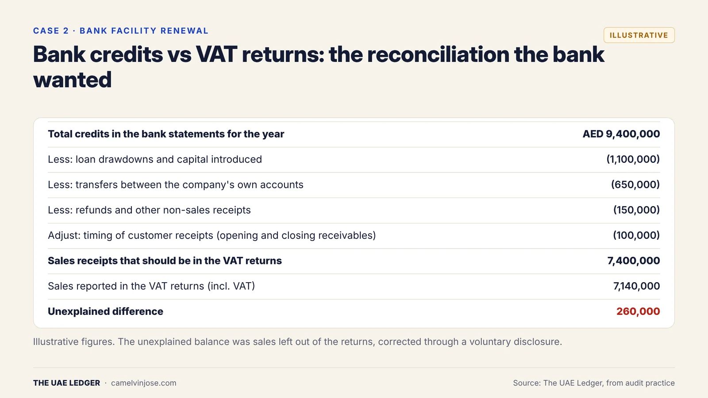
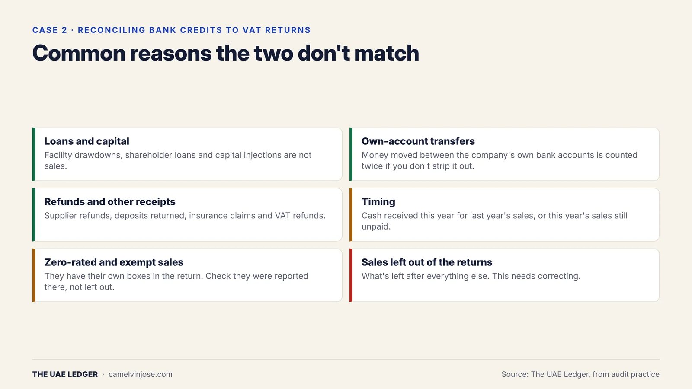

Banks used to look at your audited accounts. Many now also look at your VAT returns, and compare them with the money going into your account.

This is a case from my practice, with the client's details left out.

### What happened

A client applied to renew a bank facility. As part of its review, the bank compared the sales in the client's **VAT returns** with the **credits in its bank statements**. The two didn't match, and the bank asked for an explanation before it would go ahead.

### How we resolved it

We reconciled the bank credits to the sales in the returns. Most of the gap had ordinary explanations: money coming in that wasn't sales, and timing.

After those, a balance was left that was **sales which hadn't been reported in the VAT returns**. The client filed a **voluntary disclosure** to correct the returns, and the reconciliation went back to the bank with the explanation.

### What the reconciliation looks like

{: width="1600" height="900" loading="lazy" decoding="async"}

With illustrative figures:

| | AED |
|---|---|
| Total credits in the bank statements | 9,400,000 |
| Less: loans drawn and capital introduced | (1,100,000) |
| Less: transfers between the company's own accounts | (650,000) |
| Less: refunds and other non-sales receipts | (150,000) |
| Adjust: timing of customer receipts | (100,000) |
| **Sales receipts that should be in the returns** | **7,400,000** |
| Sales in the VAT returns, including VAT | 7,140,000 |
| **Unexplained** | **260,000** |

Compare like with like. Bank receipts include VAT, so compare them with sales **including** VAT. And include zero-rated and exempt sales, which are reported in their own boxes of the return.

### The usual reconciling items

{: width="1600" height="900" loading="lazy" decoding="async"}

- **Loans and capital:** facility drawdowns, shareholder loans and capital injections.
- **Own-account transfers:** money moved between the company's own bank accounts appears as a credit in one of them.
- **Refunds and other receipts:** supplier refunds, returned deposits, insurance claims and VAT refunds.
- **Timing:** cash received this year for last year's sales, and this year's sales still unpaid at year end.
- **Zero-rated and exempt sales:** these belong in their own boxes of the return. Check they were reported there and not left out.
- **Sales left out of the returns:** whatever remains after all of the above. That needs correcting.

Keep a document for every line. "Loan from shareholder" with nothing behind it won't satisfy a bank, an auditor or the FTA.

### When the gap is unreported sales

Unreported sales mean the VAT returns were wrong, so this stops being only a bank matter. The Tax Procedures rules decide how to correct it:

- **Over AED 10,000 of tax:** file a voluntary disclosure within 20 business days of becoming aware of the error.
- **AED 10,000 or less:** you can correct it in the return for the period in which you found it.

A voluntary disclosure carries penalties, but they're lower than if the FTA finds the error in an audit. The [Penalty Estimator]({{ '/penalty-calculator/' | relative_url }}) compares the two for your figures.

### Run the check before anyone asks

- **Reconcile bank credits to sales every quarter,** before you file the VAT return. As a routine it takes an afternoon. In the middle of a facility renewal, it takes weeks.
- **Tag non-sales receipts as they come in:** loans, capital, transfers and refunds. Year-end reconciliation becomes a report instead of a project.
- **Keep a short note and a document for every reconciling item.**
- **Fix errors promptly,** through the next return or a voluntary disclosure, depending on the amount.

Your auditor runs the same test at year end: see [what your auditor actually tests in your VAT returns]().

The other case in this pair: [the FTA query that followed a customer's tax evasion]().

**Facing the same question from your bank?** [Ask me about it]({{ '/contact/' | relative_url }}).
