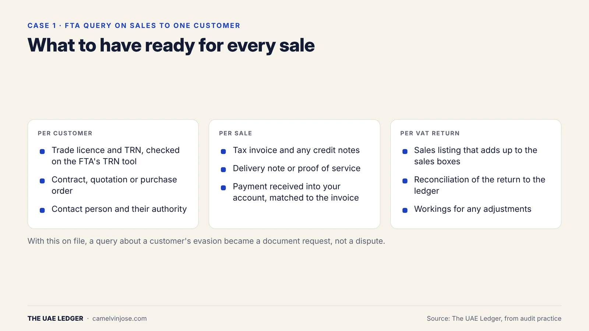
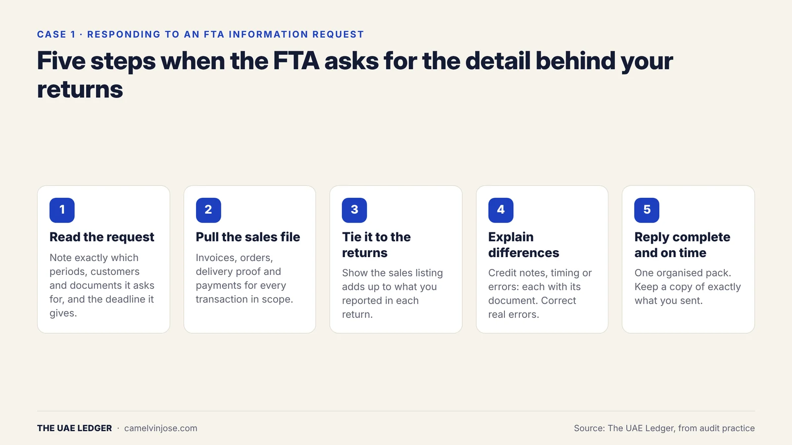

You can file every VAT return correctly and still get a letter from the FTA, because of something one of your customers did.

This is a case from my practice, with the client's details left out.

### What happened

A client received an email from the FTA asking for a detailed breakdown behind VAT returns it had already submitted. Our client hadn't done anything wrong. The reason for the request was that **one of the client's customers had been found guilty of tax evasion**, and the FTA was looking at the transactions connected to that customer.

When the FTA investigates one business, it looks at who that business bought from and sold to. Every supplier and customer in that chain can be asked to show their side of the transactions.

### How it ended

The client had the documents. Every sale to that customer was backed by the invoice and its supporting records, and the sales tied to what was reported in the returns.

The client faced no legal complications. The FTA asked for documents, the documents answered the question, and the matter ended there.

### What the client took from it

Their VAT had been right all along. What protected them was being able to **show** it was right: quickly, completely, and with paper behind every number.

Without those records, the same email could have become a much longer review of their returns, at a time when the FTA was already looking closely at that customer.

> You don't control who your customers are or what they do. You control whether your side of every transaction is documented.

### What to have ready for every sale

{: width="1600" height="900" loading="lazy" decoding="async"}

**For each customer**
- Trade licence and TRN, checked on the FTA's TRN verification tool
- The contract, quotation or purchase order
- Who you deal with there, and their authority to act

**For each sale**
- The tax invoice, and any credit notes
- A delivery note or other proof the goods or services were provided
- The payment received into your account, matched to the invoice

**For each VAT return**
- A sales listing that adds up to the sales reported in the return
- A reconciliation of the return to the ledger
- Workings for any adjustments

Keep these for the full record-keeping period, generally five years.

### If you receive a request like this

{: width="1600" height="900" loading="lazy" decoding="async"}

1. **Read the request carefully.** Note exactly which periods, customers and documents it asks for, and the deadline it gives.
2. **Pull the sales file** for every transaction in scope: invoices, orders, delivery proof and payments.
3. **Tie it to the returns.** Show that the sales listing adds up to what you reported for each period.
4. **Explain any differences** with a document for each: credit notes, timing, or errors. If you find a real error, correct it. Errors over AED 10,000 of tax need a voluntary disclosure; the [Penalty Estimator]({{ '/penalty-calculator/' | relative_url }}) shows what that costs.
5. **Reply complete and on time,** as one organised pack, and keep a copy of exactly what you sent.

If the request is unclear or covers a large volume, get help early rather than close to the deadline.

### The purchase side is now stricter too

This case was about sales. On purchases, the bar has risen: since 1 October 2026, FTA Decision No. 13 lets the FTA reject your input VAT if a supplier in your chain evaded tax and you should have been aware of it. The [five-part Decision No. 13 series]() covers the checks, and the [Supplier Verification tool]({{ '/supplier-check/' | relative_url }}) builds the record for each supplier.

The other case in this pair: [a bank that compared VAT returns with bank credits]().

**Had a similar request?** [Ask me about it]({{ '/contact/' | relative_url }}).
