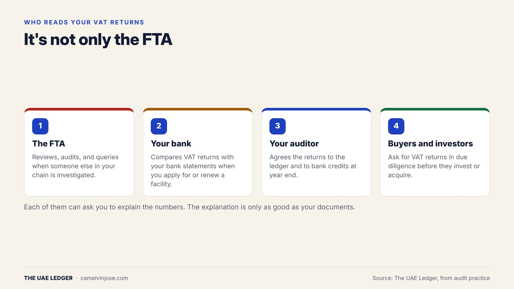
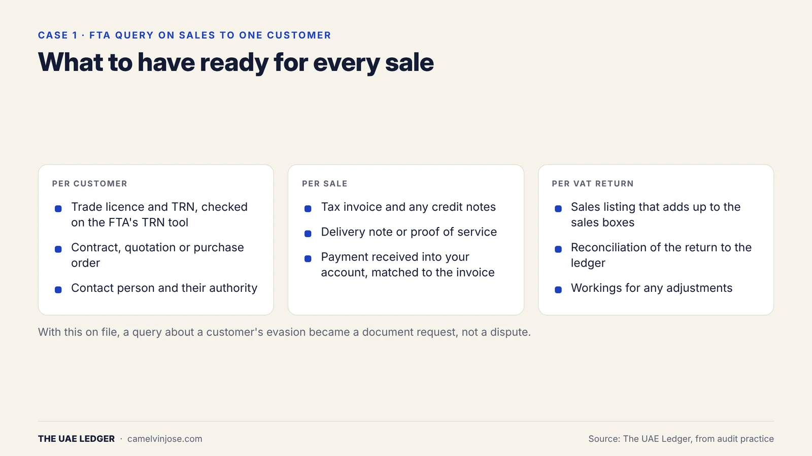
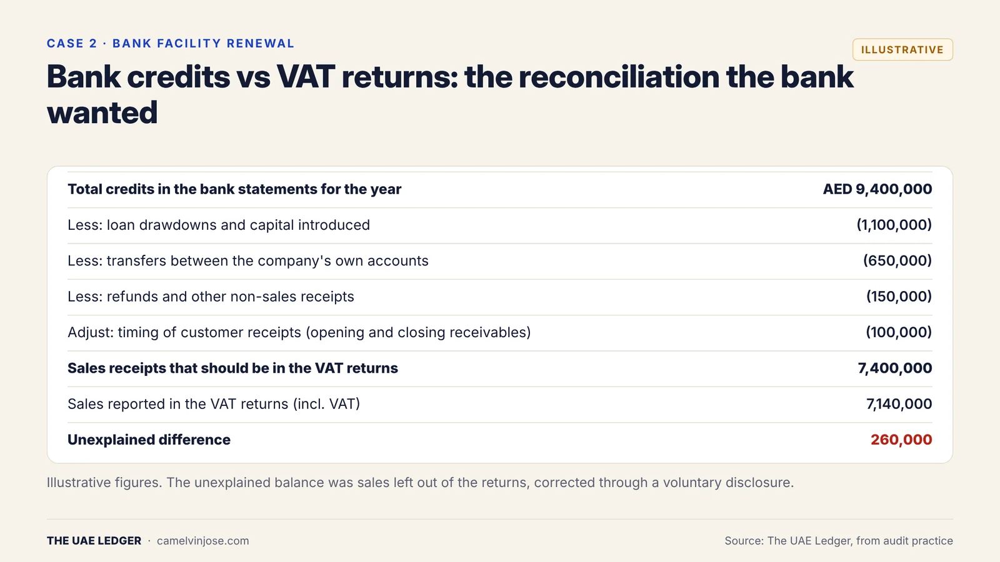

Most businesses think of their VAT returns as something they send to the FTA and forget. They're wrong about the forgetting part.

Your returns get read again by the FTA when someone else in your supply chain is investigated, by your bank when you renew a facility, by your auditor at year end, and by any buyer or investor doing due diligence. Each of them can ask you to explain the numbers.

Here are two cases from my practice, with client details left out, and what they show about the files you should keep.

{: width="1600" height="900" loading="lazy" decoding="async"}

### Case 1: the FTA asks about your sales to one customer

**What happened.** A client received an email from the FTA asking for a detailed breakdown behind VAT returns they had already filed. The reason: one of the client's customers had been found guilty of tax evasion, and the FTA was tracing transactions connected to that customer.

**How it ended.** The client had the documents. Every sale to that customer was backed by the invoice and the supporting records, and the returns tied to them. The client faced no legal complications. The query was answered with documents, and it ended there.

**What they took from it.** Their own VAT was correct the whole time. What protected them was being able to *show* it was correct, quickly and completely. Without those records, the same query could have turned into a much longer review of their returns.

**The lesson:** you don't control who your customers are or what they do. You control whether your own side of every transaction is documented. When the FTA investigates someone in your chain, your records are your defence.

{: width="1600" height="900" loading="lazy" decoding="async"}

This is the sales-side version of the supplier checks the FTA now expects on purchases. If you buy from suppliers, the [Decision No. 13 series]() covers what to verify, and the [Supplier Verification tool]({{ '/supplier-check/' | relative_url }}) builds the record for you.

### Case 2: the bank compares your VAT returns with your bank statements

**What happened.** A client applied to renew a bank facility. As part of its review, the bank compared the sales in the client's VAT returns with the credits in the client's bank statements. They didn't match, and the bank asked for an explanation before it would proceed.

**How it ended.** We reconciled the two. Most of the gap had ordinary explanations. A balance remained that was sales which hadn't been reported in the VAT returns. The client filed a voluntary disclosure to correct those returns, and the explanation went back to the bank.

Here's the shape of that reconciliation, with illustrative figures:

{: width="1600" height="900" loading="lazy" decoding="async"}

| | AED |
|---|---|
| Total credits in the bank statements | 9,400,000 |
| Less: loans drawn and capital introduced | (1,100,000) |
| Less: transfers between the company's own accounts | (650,000) |
| Less: refunds and other non-sales receipts | (150,000) |
| Adjust: timing of customer receipts | (100,000) |
| **Sales receipts that should be in the returns** | **7,400,000** |
| Sales in the VAT returns, including VAT | 7,140,000 |
| **Unexplained** | **260,000** |

**The lesson:** banks now do the check that auditors do. If your returns and your bank credits don't reconcile, you find out at the worst moment, when you need the facility renewed. And once the gap is found, it isn't only a bank problem: unreported sales mean the returns were wrong, and the FTA rules on correcting them apply.

### Correcting errors: voluntary disclosure

If you find that a filed return understated the tax due, the Tax Procedures rules decide how to fix it:

- **Over AED 10,000 of tax:** file a voluntary disclosure within 20 business days of becoming aware of the error.
- **AED 10,000 or less:** you can correct it in the return for the period in which you found it.

A voluntary disclosure carries penalties, but they're lower than if the FTA finds the error itself. The [Penalty Estimator]({{ '/penalty-calculator/' | relative_url }}) shows what a disclosure would cost against an FTA finding for your figures.

Finding the error yourself, before a bank or the FTA does, is always the cheaper route.

### What to do before anyone asks

- **Reconcile bank credits to sales every quarter,** before you file the VAT return, not once a year. The check in Case 2 takes an afternoon when it's routine and weeks when it isn't.
- **Keep a sales file per customer:** trade licence, TRN check, contract or order, invoices, delivery proof and payment matched to each invoice.
- **Reconcile each return to the ledger** and keep the workings with the return.
- **Correct errors promptly** through the next return or a voluntary disclosure, depending on the amount.
- **Keep it all for the full record-keeping period,** generally five years.

The year-end version of these checks, and the others an auditor runs, is in [what your auditor actually tests in your VAT returns]().

**Have a similar situation?** [Ask me about it]({{ '/contact/' | relative_url }}).
