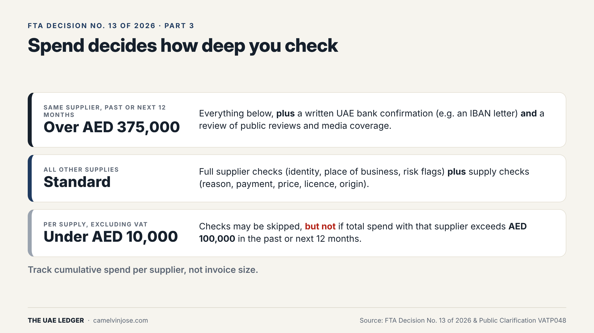
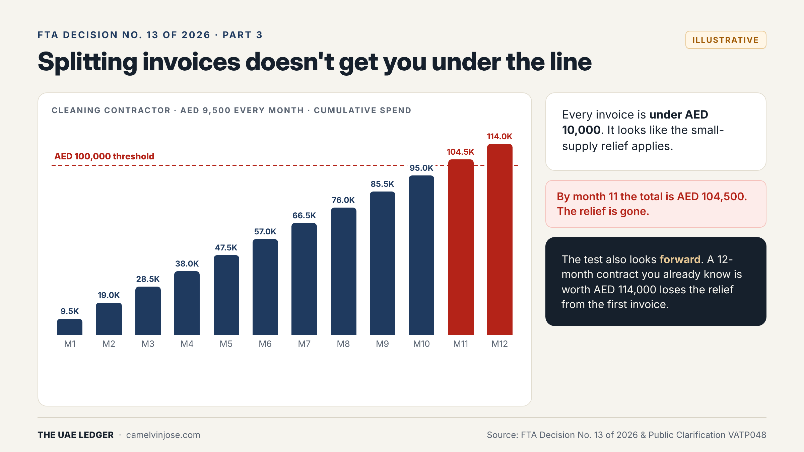
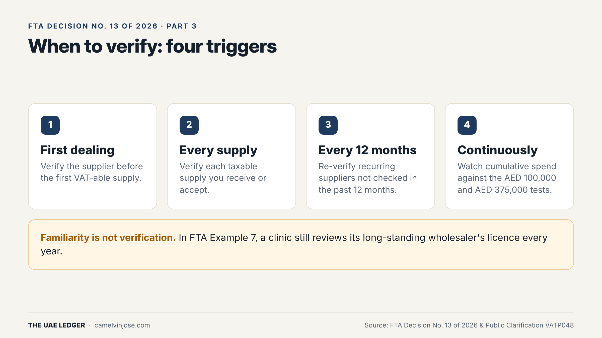

[Part 2]() covered *what* to check about a supplier. This part covers **how deep** you need to go, and **how often**.

The answer comes down to three numbers. Get them wrong and you either over-check every AED 300 stationery order, or under-check the supplier who actually matters.

### The three tiers

**Under AED 10,000 per supply (excluding VAT)**
The checks may be skipped. **But not** if the total spend with that supplier exceeds **AED 100,000** in the past 12 months or the next 12 months.

**Standard: all other supplies**
Full supplier checks (identity, place of business, risk indicators) **plus** supply checks (commercial reason, payment, price, licence scope, goods origin). We cover the supply checks in Part 4.

**Over AED 375,000 with the same supplier (past or next 12 months)**
Everything above, **plus**:
- a written confirmation of the supplier's UAE bank account (for example, an IBAN letter), and
- a review of public reviews and media coverage of the supplier.

The key word in all three: **supplier**. The tests look at cumulative spend per supplier, not the size of an individual invoice.

### Why splitting invoices doesn't help

Here is an illustrative example. You use a cleaning contractor at **AED 9,500 a month**. Every single invoice is under AED 10,000, so it looks like the small-supply relief applies.

It doesn't, for two reasons:

1. **Backward-looking:** by month 11, total spend is AED 104,500. You are over AED 100,000 in the past 12 months, so the relief is gone.
2. **Forward-looking:** the test also covers the *next* 12 months. If you signed a 12-month contract you already know is worth AED 114,000, the relief is lost **from the first invoice**.

The same forward-looking logic applies at AED 375,000. An expected contract value counts. If you're about to sign a AED 400,000 annual fit-out or IT contract, the bank letter and reputation review belong in onboarding, not in month nine.

**Practical takeaway:** your AP system needs a running 12-month spend total per supplier, plus a flag for known contract values. Invoice-level controls won't catch this.

### When to verify: four triggers

1. **First dealing:** verify the supplier before the first VAT-able supply.
2. **Every supply:** verify each taxable supply you receive or accept.
3. **Every 12 months:** re-verify recurring suppliers who haven't been checked in the past 12 months.
4. **Continuously:** monitor cumulative spend against the AED 100,000 and AED 375,000 tests.

The trap is trigger 3. Long-standing suppliers feel safe, so nobody re-checks them. The FTA's own Example 7 (Part 4) shows a clinic reviewing its *usual* wholesaler's licence every year. **Familiarity is not verification.**

### Set it up in your books

If you run Tally or any ERP, three fields on the vendor master do most of the work:

| Field | What it does |
|---|---|
| **Spend tier** (Under 10K / Standard / Over 375K) | Tells AP which checks must be on file |
| **Last verified date** | Drives the 12-month re-verification |
| **Expected 12-month contract value** | Catches the forward-looking test before the first invoice |

Run a monthly report on rolling 12-month spend per supplier and review anyone who crossed AED 100,000 or AED 375,000 since last month.

**Next, Part 4:** the supplier checks out. Now, is the *transaction* itself genuine? Four red flags from FTA Examples 4 to 7.
