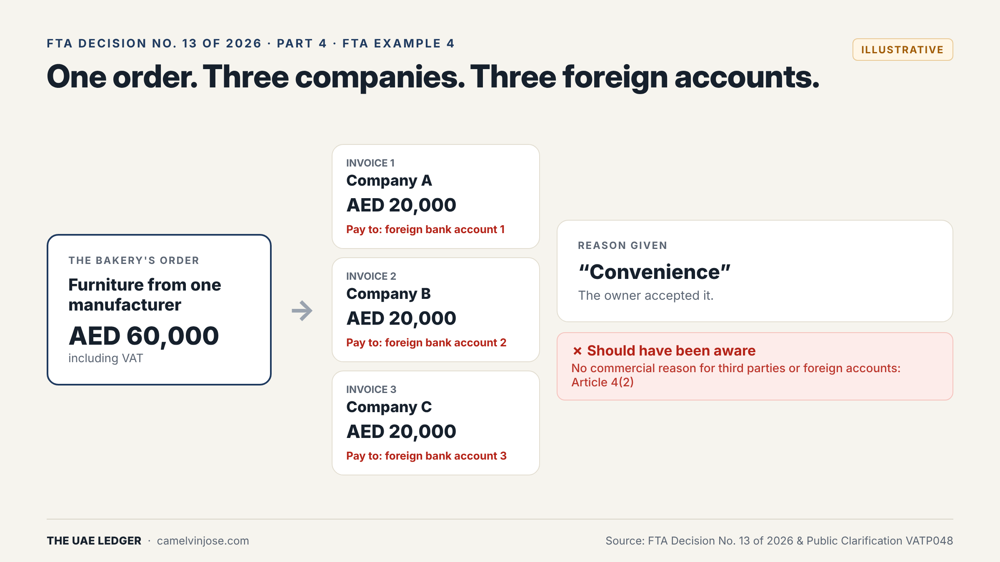
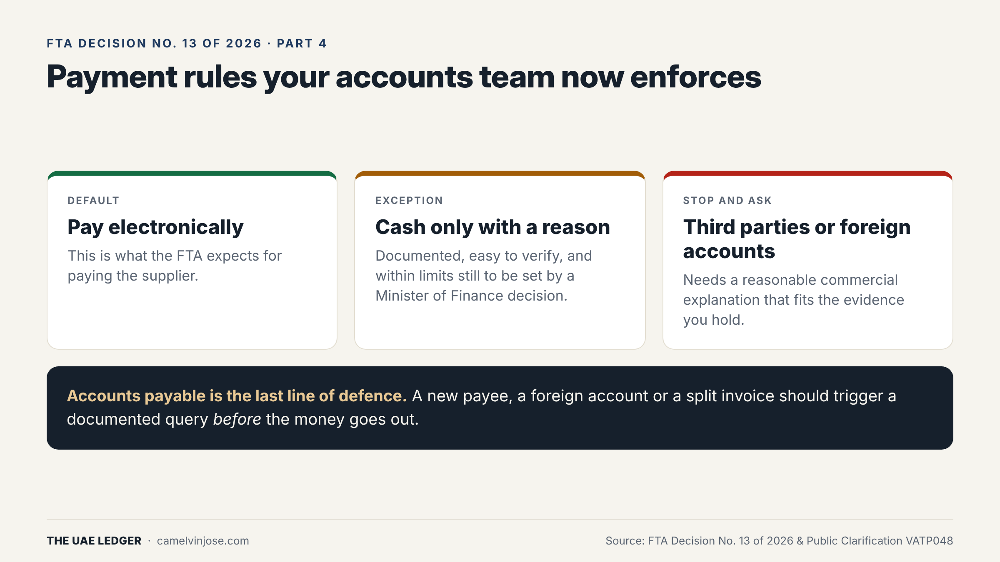
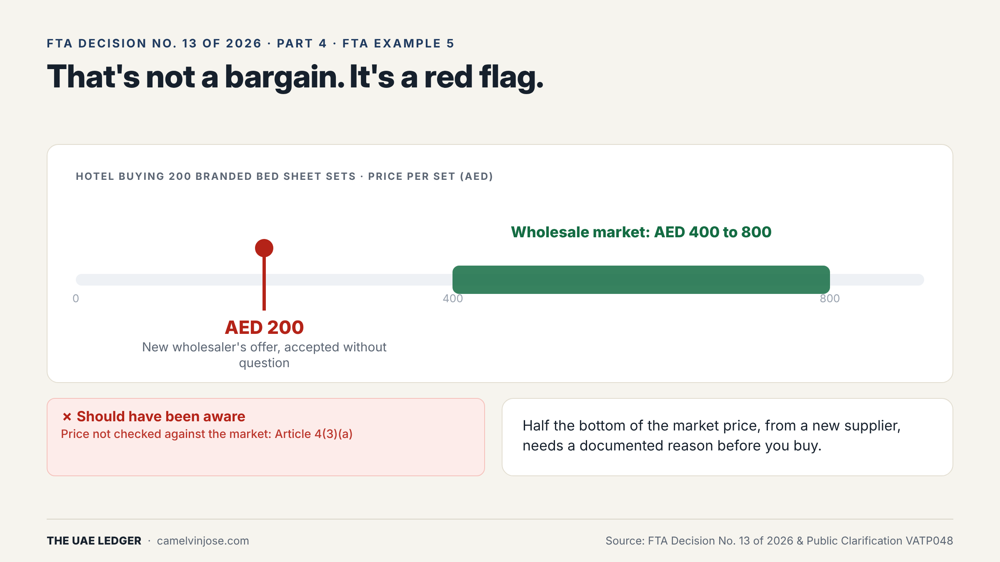
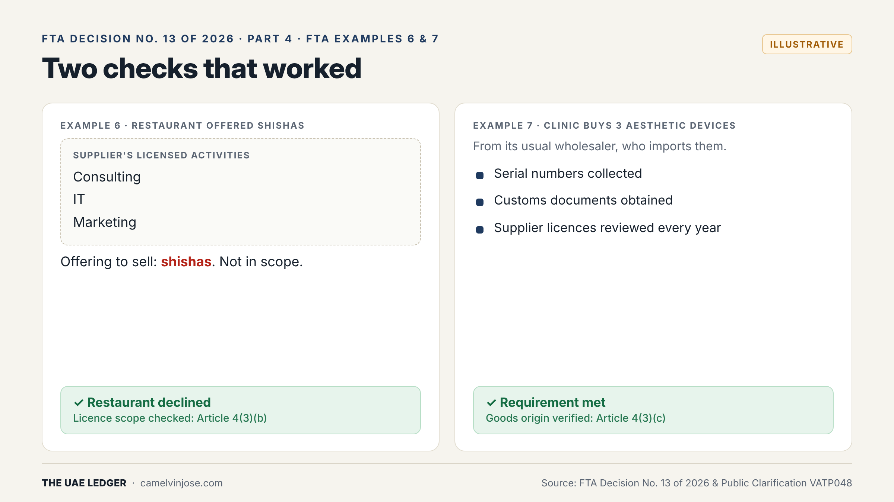

A supplier can pass every identity check in [Part 2]() and still be part of an evasion chain. That is why Article 4 of Decision No. 13 shifts the focus from **who** you buy from to **what** you are buying, and **how you pay**.

There are six supply checks:

- **Commercial reason:** the supplier's involvement rests on genuine commercial reasons.
- **Payment conditions:** the method and terms make commercial sense. Electronic payment is the default.
- **Price and margin:** not unjustifiably far from market without a clear reason.
- **Licence scope:** what you buy falls within the supplier's ordinary or licensed activity.
- **Goods origin:** authenticity, origin, and the supplier's right to sell the goods.
- **Intermediaries:** a clear, justified commercial reason for any middleman's role.

The FTA illustrates four of these with worked examples. Two businesses lost; two got it right.

### Red flag 1: the payment doesn't make sense (Example 4)

A bakery orders furniture worth **AED 60,000 (including VAT)** from one manufacturer. It is billed as **three AED 20,000 invoices from three different companies**, each naming a **different foreign bank account**. The reason given: *"convenience"*. The owner accepts it.

**Result:** *should have been aware*. There was no commercial reason for third parties or foreign accounts, under Article 4(2).

The payment rules in plain terms:

- **Pay electronically.** This is the expected default.
- **Cash only with a reason:** documented, easy to verify, and within limits still to be set by a Minister of Finance decision. Those limits haven't been published yet.
- **Third parties or foreign accounts** need a reasonable commercial explanation that fits the evidence you hold.

**Accounts payable is your last line of defence.** A change of payee, a foreign account or a split invoice should trigger a documented query *before* payment, not after.

### Red flag 2: the price is too good (Example 5)

A hotel needs **200 branded bed sheet sets**. The wholesale market price is **AED 400 to 800 per set**. A new wholesaler offers **AED 200**. The hotel accepts without question.

**Result:** *should have been aware*. The price wasn't checked against the market, under Article 4(3)(a).

Half the bottom of the market range is not a bargain. It's a flag. A big discount can be legitimate (clearance stock, a closing business), but you need that reason **in writing, before you buy**.

### Checks that worked: licence scope and goods origin (Examples 6 and 7)

**Example 6: the restaurant.** A new wholesaler offers to sell shishas. The restaurant checks the trade licence. It covers **consulting, IT and marketing only**. The restaurant declines.

**Result:** the check worked. Licence scope verified under Article 4(3)(b). A two-minute licence check stopped a bad purchase.

**Example 7: the clinic.** The clinic's usual wholesaler imports **three aesthetic devices**. The clinic collects **serial numbers and customs documents**, and still **reviews the supplier's licences every year**.

**Result:** requirement met. Goods origin verified under Article 4(3)(c). Even a long-standing supplier gets re-checked.

### Your supply checklist (copy this)

For every taxable supply above the small-supply threshold:

- Why this supplier? Commercial reason noted
- Paid electronically to an account in the supplier's own name. If not: written reason
- Price compared with market (two quotes, a price list or a past purchase). If far off: written reason
- Goods or services fall within the supplier's licensed activity
- For goods: origin evidence kept (serial numbers, customs documents, distributor authorisation)
- Any intermediary: their role and why it's needed, in writing

**Next, Part 5:** the final piece. If none of this is documented, none of it happened. The evidence file, the written policy, FTA Example 8 and a 6-step plan to get compliant.
