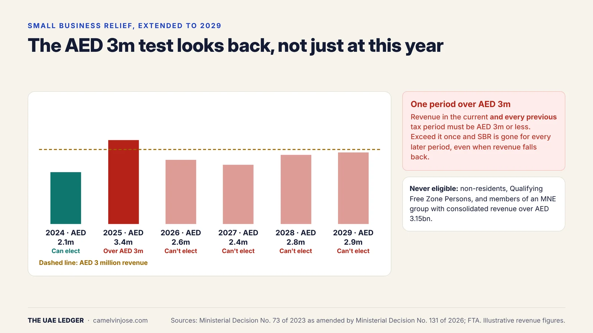

Small Business Relief (SBR) was due to end with tax periods finishing on 31 December 2026. In August, **Ministerial Decision No. 131 of 2026** extended it by three years, to tax periods ending on or before **31 December 2029**. The AED 3 million threshold didn't change.

For a small business that qualifies, SBR means it's treated as having **no taxable income** for the period. The catch is in the word "qualifies".

### Who can elect it

A business can elect SBR for a tax period if all of these are true:

1. **It's a UAE resident person.** Companies and individuals in business both count. Non-residents can't elect it.
2. **Revenue is AED 3 million or less in the current tax period.**
3. **Revenue was AED 3 million or less in every previous tax period** too. This is the condition people miss.
4. **It isn't a Qualifying Free Zone Person.** QFZPs have their own regime and can't use SBR. ([QFZP conditions]())
5. **It isn't part of a multinational group** with consolidated revenue over AED 3.15 billion.

Revenue here is total revenue under the accounting standards you use, from all sources. It's a **revenue** test, not a profit test.

### The test that looks back

{: width="1600" height="900" loading="lazy" decoding="async"}

The FTA's own example: a business had revenue of AED 4.3 million for the year to 31 December 2025, then AED 1.9 million for 2026. It can't claim SBR for 2026, because an earlier period was over the line.

So the extension to 2029 doesn't help a business that crossed AED 3 million in 2024 or 2025. It helps those that have **stayed under** the line every year since their first tax period, and it makes that history worth protecting. A one-off contract that takes revenue to AED 3.1 million costs more than the tax on that year: it closes SBR for every year after.

### What you give up by electing

SBR isn't free. In a period where you elect it:

- **Tax losses** incurred in that period can't be carried forward to later periods.
- **Other reliefs and deductions** don't apply, because the business is simply treated as having no taxable income.
- **Arm's-length rules still apply** to related-party transactions, although transfer pricing documentation isn't required.

For most small businesses with a profit, electing is still the right call. For a business making a loss that expects to grow past AED 3 million, it can be better **not** to elect and keep the loss for later. Run both numbers before you file.

### Splitting the business doesn't work

If the FTA finds that a business was **artificially separated** into smaller entities to keep each one under AED 3 million, SBR is denied. Several related companies each just under the line, doing the same work for the same customers, is exactly what this rule targets.

### How to claim it

SBR is **not automatic**. You must:

1. **Register** for Corporate Tax.
2. **File the Corporate Tax return** within 9 months of the end of the tax period.
3. **Elect SBR** in that return, for each period.

Keep the evidence of revenue for every period, including the earlier ones the test looks back at. A business that elects SBR but can't show its earlier revenue is exposed if the FTA asks.

### What it's worth

Without SBR, Corporate Tax is 0% on the first AED 375,000 of taxable income and 9% above that. A business with taxable income of AED 600,000 would pay **AED 20,250** (9% of AED 225,000). With SBR, it pays nothing. Over the three extra years to 2029, that's up to about **AED 60,750** for a business at that level.

### What to do now

1. **Pull revenue for every tax period** since your first one, not just this year.
2. **If you're close to AED 3 million**, plan large contracts and their timing with the test in mind.
3. **Check whether a loss** is worth more carried forward than an SBR election this year.
4. **If you run several small entities**, make sure each has a genuine commercial reason to exist separately.
5. **File and elect** in every return; doing nothing doesn't count as claiming.

The [Tax Calculator]({{ '/calculator/' | relative_url }}) works out Corporate Tax with and without SBR, and the [Compliance Checker]({{ '/compliance-check/' | relative_url }}) shows which obligations apply. Tax Groups have their own rules on SBR: see [losses, interest and reliefs in a Tax Group]().

**Sources:** [Ministerial Decision No. 131 of 2026](https://mof.gov.ae/en/news/ministry-of-finance-announces-extension-of-small-business-relief-for-corporate-tax-purposes-until-31-december-2029/) (Ministry of Finance announcement, 7 August 2026); Ministerial Decision No. 73 of 2023 on Small Business Relief; [FTA: Small Business Relief](https://tax.gov.ae/en/taxes/corporate.tax/corporate.tax.topics/small.business.relief.23.aspx); FTA Corporate Tax Guide on Small Business Relief (CTGSBR1).
